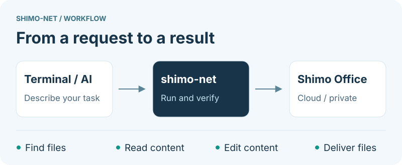

<h1 align="center">shimo-net</h1>

<p align="center"><strong>Shimo Office in your terminal and AI assistant</strong><br />Find files · Read content · Manage folders · Edit spreadsheets<br />For shimo.net and private deployments</p>

<p align="center">
  <a href="README.md">简体中文</a> · <strong>English</strong><br />
  <a href="docs/en/README.md">Documentation</a> · <a href="docs/en/agent/README.md">AI assistant guide</a> · <a href="docs/en/install.md">Installation</a> · <a href="docs/en/cli-reference.md">CLI reference</a>
</p>

<p align="center">
  <a href="https://www.npmjs.com/package/shimo-net-cli"></a>
  <a href="https://github.com/shimo-office/office-suites/releases"></a>
  <a href="https://github.com/shimo-office/office-suites/actions/workflows/ci.yml"></a>
</p>



## What you can do

`shimo-net` connects Shimo files to command-line and AI workflows. Run commands yourself, or let an assistant with local tools follow the Skill instructions and run them for you.

| Capability | Typical tasks |
|---|---|
| Files and folders | Search, upload, import, download, create, rename and move to trash |
| Content | Read document text and spreadsheet data for summaries or scripts |
| Spreadsheets and editing | Read and write cells, manage rows and formatting; use supported document and slide actions |
| Environments and collaboration | Connect to public or private deployments, respect account permissions and return JSON |

See [workflows and supported scope](docs/en/scenarios.md) for details. Page-based editing needs an available, authorized browser. Being able to create a file type does not imply support for every editing feature.

## Quick start

### Ask your AI assistant

Send this to an assistant that can access the internet and run commands on your computer:

```text
Please install and configure shimo-net using this guide:
https://github.com/shimo-office/office-suites/blob/main/docs/agent/setup.md
Connect the Skill to this assistant, reuse any working installation,
and verify connectivity so I can work with Shimo in natural language.
```

Complete browser login or authorization when prompted, then try:

```text
Find “Quarterly report” in Shimo and list the file names and links.
After I choose a file, summarize its main points and action items.
```

For a private deployment, include your company's Shimo URL. Follow the [illustrated four-step guide](docs/en/agent/README.md), with notes for [WorkBuddy](docs/en/agent/workbuddy.md), [Codex](docs/en/agent/codex.md), [DSH](docs/en/agent/dsh.md) and [Doubao Work](docs/en/agent/doubao.md). The linked setup instructions are maintained in Chinese for the agent to read.

### Use your terminal

With Node.js 18+ and npm installed:

```bash
npm install -g shimo-net-cli --registry=https://registry.npmjs.org
shimo-net version --json
shimo-net login
shimo-net whoami --json
shimo-net search "Quarterly report" --json
```

The npm package is **`shimo-net-cli`**; the command is **`shimo-net`**. npm installs the program, not assistant Skills or your Shimo session. For a private deployment, [configure the service URL](docs/en/install.md) before logging in.

The CLI is a native Go program. You can also use the [curl setup script, platform binaries or source build](docs/en/install.md) without Node.js. macOS, Linux and Windows are supported on x64 and ARM64.

### Update the CLI

Versions that support the update command can run:

```bash
shimo-net update --check  # Check for a newer release
shimo-net update          # Update the current installation
shimo-net version        # Confirm the installed version
```

Add `--json` for structured output. npm installations update the whole package; native installations validate and replace the executable. Updates do not downgrade or change Shimo login, configuration, or assistant Skills. If an older version reports an unknown `update` command, upgrade once using the [npm guide](docs/en/npm.md#update-or-pin-a-version) or [native installation guide](docs/en/install.md). See the [update command reference](docs/en/cli-reference.md#update-the-cli) for arguments and result fields.

## Common commands

Replace placeholders with accessible Shimo links. Add `--json` to data commands for script-friendly output.

```bash
shimo-net ls "<folder-url>" --json
shimo-net read "<document-url>" --json
shimo-net get "<file-url>" --out ./downloads --json
shimo-net schema --json
shimo-net doctor --json
```

See the [CLI reference](docs/en/cli-reference.md) for parameters and the [installation guide](docs/en/install.md) for troubleshooting.

## Documentation

| Your goal | Start here |
|---|---|
| Work through an AI assistant | [Assistant guide](docs/en/agent/README.md) |
| Install, log in, switch accounts or use a private deployment | [Installation](docs/en/install.md) |
| Update, pin a version or uninstall with npm | [npm guide](docs/en/npm.md) |
| Explore tasks and supported scope | [Workflows](docs/en/scenarios.md) |
| Look up commands, parameters and results | [CLI reference](docs/en/cli-reference.md) |
| Find agent instructions and maintainer resources | [Documentation index](docs/en/README.md) |
| Review version changes | [Changelog (Chinese)](CHANGELOG.md) |

If a problem persists, [open an issue](https://github.com/shimo-office/office-suites/issues) with your version, operating system, reproduction steps and sanitized error output.

## Security and license

The CLI uses your current account's permissions. Permission changes, file locking, editing restrictions and permanent deletion require manual action on the Shimo website; `delete` only moves files to trash. Never share passwords or cookies. See the [security policy (Chinese)](SECURITY.md).

All rights reserved. Copying, modification, distribution, sublicensing or commercial use requires prior written authorization from the shimo-office team. See [LICENSE](LICENSE) for the full terms. [Learn about Shimo Office Suites](https://shimo.net/products/office-suites).
