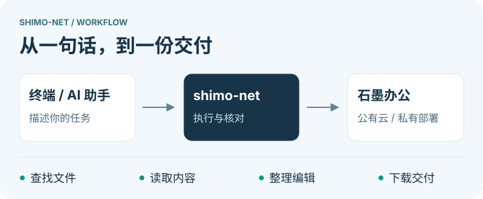

<h1 align="center">shimo-net</h1>

<p align="center"><strong>在终端和 AI 助手中使用石墨办公</strong><br />搜索文件 · 读取内容 · 管理目录 · 编辑表格<br />支持 shimo.net 与客户私有部署</p>

<p align="center">
  <strong>简体中文</strong> · <a href="README.en.md">English</a><br />
  <a href="docs/README.md">文档导航</a> · <a href="docs/agent/README.md">AI 助手入门</a> · <a href="docs/install.md">安装指南</a> · <a href="docs/cli-reference.md">命令参考</a>
</p>

<p align="center">
  <a href="https://www.npmjs.com/package/shimo-net-cli"></a>
  <a href="https://github.com/shimo-office/office-suites/releases"></a>
  <a href="https://github.com/shimo-office/office-suites/actions/workflows/ci.yml"></a>
</p>



## 能做什么

`shimo-net` 把石墨文件接入命令行和 AI 工作流。你可以自己运行命令，也可以让支持本机工具的助手读取 Skill 后代为执行。

| 能力 | 常见用途 |
|---|---|
| 文件与目录 | 搜索、上传、导入、下载、新建、改名与回收 |
| 内容读取 | 读取正文和表格数据，供助手总结或脚本处理 |
| 表格与编辑 | 读写单元格、处理行和格式；按支持范围编辑文稿、幻灯片等 |
| 环境与协作 | 连接公有云或私有部署，按当前账号权限操作，输出 JSON |

具体支持范围见[办公场景](docs/scenarios.md)。需要页面的编辑操作依赖可用且获准使用的浏览器；创建某种文件不代表支持它的全部编辑功能。

## 快速开始

### 让 Agent 一句话安装

把下面的请求发给能联网并执行本机命令的 AI 助手：

```text
请帮我安装并配置 shimo-net，按这份说明执行：
https://github.com/shimo-office/office-suites/blob/main/docs/agent/setup.md
请自动接入当前助手的技能并验证连通，已有可用安装就复用。
完成后让我直接用自然语言操作石墨。
```

按提示完成网页登录或授权，就可以说：

```text
帮我在石墨里找到“季度报告”，先列出文件名和链接；我选好后，再总结主要内容和待办事项。
```

私有部署用户在安装请求中补充公司的石墨网址。完整过程见[四步图文教程](docs/agent/README.md)；助手差异见 [WorkBuddy](docs/agent/workbuddy.md) · [Codex](docs/agent/codex.md) · [DSH](docs/agent/dsh.md) · [豆包工作](docs/agent/doubao.md)。

### 自己在终端使用

已有 Node.js 18+ 与 npm 时：

```bash
npm install -g shimo-net-cli --registry=https://registry.npmjs.org
shimo-net version --json
shimo-net login
shimo-net whoami --json
shimo-net search "季度报告" --json
```

npm 包名为 **`shimo-net-cli`**，命令名为 **`shimo-net`**。npm 只安装程序；它不负责助手技能和石墨登录。私有部署请先按[服务地址配置](docs/install.md#初始化与私有部署)设置域名，再登录。

<a id="安装"></a>
不想安装 Node.js？CLI 本体是 Go 原生程序，也可使用 [curl 配置脚本](docs/install.md#curl-一键配置)、[平台二进制](docs/install.md#直接下载原生程序)或[源码构建](docs/install.md#源码构建与本地开发)。支持 macOS、Linux、Windows 的 x64 / ARM64。

### 更新 CLI

支持更新命令的版本可以直接执行：

```bash
shimo-net update --check  # 只检查是否有新版本
shimo-net update          # 更新当前安装
shimo-net version        # 确认更新后的版本
```

支持 `--json`。npm 安装会更新整个包，原生安装会校验并替换程序；不会降级或修改石墨登录、配置和助手技能。旧版若提示“未知命令 update”，请先按 [npm 更新说明](docs/npm.md#更新与指定版本)或[原生安装说明](docs/install.md#直接下载原生程序)升级一次。参数与返回字段见[更新命令](docs/cli-reference.md#更新-cli)。

## 常用命令

将占位符换成你有权限访问的石墨链接；数据命令加 `--json` 便于解析。

```bash
shimo-net ls "<文件夹链接>" --json
shimo-net read "<文档链接>" --json
shimo-net get "<文件链接>" --out ./downloads --json
shimo-net schema --json
shimo-net doctor --json
```

完整参数见[命令参考](docs/cli-reference.md)。登录失败、找不到命令等问题见[排错指南](docs/install.md#faq)。

<a id="在-ai-助手中使用"></a>
## 文档

| 你要做什么 | 从这里开始 |
|---|---|
| 让 AI 助手帮你办公 | [助手入门](docs/agent/README.md) |
| 安装、登录、切账号或连接私有部署 | [安装指南](docs/install.md) |
| 用 npm 更新、固定版本或卸载 | [npm 专项指南](docs/npm.md) |
| 看能做什么、如何描述任务 | [办公场景](docs/scenarios.md) |
| 查命令、参数和返回结果 | [命令参考](docs/cli-reference.md) |
| 查 Agent 接入说明、维护资料 | [完整文档导航](docs/README.md) |
| 了解版本变化 | [更新记录](CHANGELOG.md) |

遇到无法解决的问题，可[提交 Issue](https://github.com/shimo-office/office-suites/issues)，附版本、系统、复现步骤和去除敏感信息的错误提示。

## 安全与许可

CLI 按当前账号权限操作。权限变更、文件锁定、限制编辑和彻底删除须由用户在石墨网页完成；`delete` 只移入回收站。不要分享密码或 cookie，详见[安全策略](SECURITY.md)。

### 使用许可

本仓库保留所有权利；复制、修改、分发、再许可或商业使用须事先获得 shimo-office 团队的书面授权。完整条款见 [LICENSE](LICENSE)。[了解石墨办公套件](https://shimo.net/products/office-suites)。
