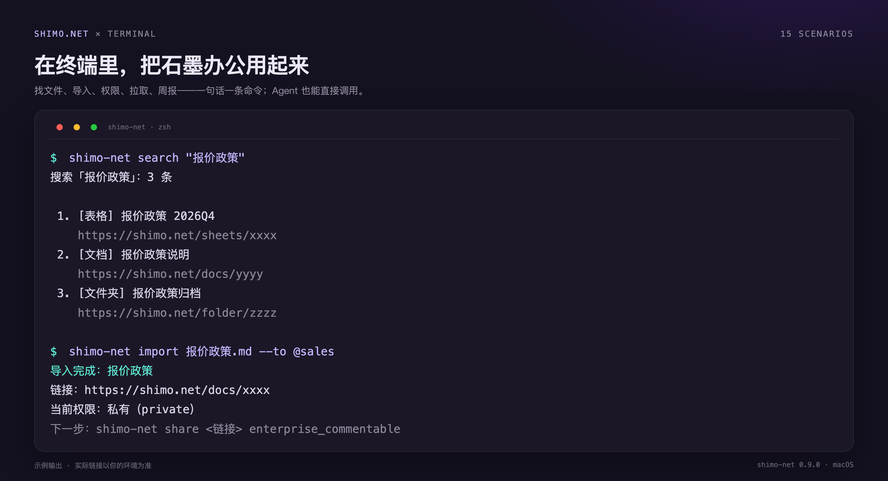
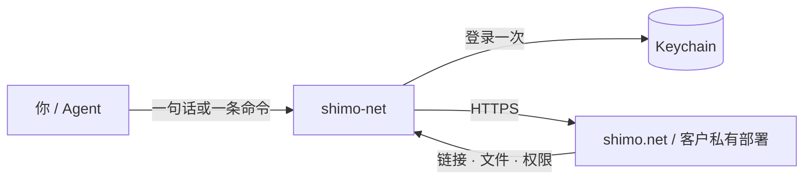

<div align="center">

# shimo-net

**石墨办公 CLI：在终端里，把 shimo.net 用起来。**

找文件 · 导入交付 · 拉取归档 · 权限巡检 · 周报 · 上传下载

[](https://github.com/shimo-office/office-suites/releases)
[](https://github.com/shimo-office/office-suites/actions/workflows/ci.yml)
[](#环境要求)

</div>



不用打开浏览器一层层翻文件夹，也不用记链接。找文件、导文档、拉取、改权限、出周报，都可以用一句命令完成；接进 Agent 后，直接说人话就行。

---

## 30 秒上手

**macOS / Linux**

```bash
git clone https://github.com/shimo-office/office-suites.git
cd office-suites
./install.command

shimo-net init            # 第一次：确认产品网址（默认 shimo.net）
shimo-net login           # 打开 Chrome 登录一次
shimo-net search "报价政策"
```

**Windows（PowerShell）**

```powershell
git clone https://github.com/shimo-office/office-suites.git
cd office-suites
powershell -ExecutionPolicy Bypass -File .\install.ps1
shimo-net init
shimo-net login
```

> 安装器会把命令放到 `~/.local/bin/shimo-net`。有 Go 时本地构建；没有 Go 时自动下载 [release](https://github.com/shimo-office/office-suites/releases) 里的 macOS / Linux 二进制。如果提示找不到命令，把 `~/.local/bin` 加进 `PATH`。

**客户私有部署**只改网址，不另装一套：

```bash
shimo-net init --origin https://<客户域名>
shimo-net login
```

---

## 它能帮你做什么

| 以前 | 现在 |
|---|---|
| 在石墨里翻好几层文件夹找一份表 | `shimo-net search "报价政策"`，直接给链接 |
| 把 md 导成在线文档，再手动设权限 | `shimo-net import 方案.md --to @team`，导入后问你权限 |
| 把整个文件夹下载下来归档 | `shimo-net pull @project --out ./归档`，附 `manifest.json` |
| 检查空间里谁开了公开链接 | `shimo-net audit @team`，列出公开项并给收回建议 |
| 周五翻文档手写周报 | `shimo-net ls @team --since 7d` + `shimo-net read`，出一页纸 |
| 上传附件时选错空间 | `shimo-net upload 报告.pdf`，先问传到哪里再传 |
| 每次都要复制粘贴常用文件夹链接 | `shimo-net fav add ai <链接>`，以后直接 `@ai` |

完整 15 个场景见 [cli/scenarios.md](cli/scenarios.md)。

---

## 在 Agent 里怎么用

CLI 自带一份技能定义 [cli/SKILL.md](cli/SKILL.md)。把它装进 Agent 后，用户只需要说「找一下报价政策」「把这个 md 导到 AI 方案」，Agent 会自己调用命令。

### 1. 安装技能

<details>
<summary><b>DeepSeek Harness</b></summary>

```bash
mkdir -p ~/.dsh/skills/shimo-net-cli
cp cli/SKILL.md ~/.dsh/skills/shimo-net-cli/SKILL.md
```

新开一个会话，技能会按描述自动加载。
</details>

<details>
<summary><b>Codex</b></summary>

```bash
mkdir -p ~/.codex/skills/shimo-net-cli
cp cli/SKILL.md ~/.codex/skills/shimo-net-cli/SKILL.md
```

在项目 `AGENTS.md` 里加一句：

```text
涉及石墨 / shimo.net 时，优先用 `shimo-net` 命令；先 `whoami`，401 就 `login` 后重试。
```
</details>

<details>
<summary><b>WorkBuddy</b></summary>

在左侧栏「专家 · 技能 · 连接器」→「技能」→「添加技能」→「上传技能」，选择 `cli/SKILL.md`（或包含它的技能包）。安装后在「已安装」里确认已启用。
</details>

<details>
<summary><b>豆包工作</b></summary>

在「技能」→「上传技能」选择 `cli/SKILL.md`；如果当前版本只支持录制，用「录制技能」录一遍 `shimo-net` 命令，再把参数改成变量。
</details>

<details>
<summary><b>其他 Agent</b></summary>

任何能执行 shell 的 Agent 都可以直接用。把 `shimo-net` 装进 `PATH`，再给它这段约束：

```text
涉及石墨时用 shimo-net 命令，全部加 --json。
先跑 whoami；401 就执行 login 后重试原命令。
写操作先给目标链接和影响范围，确认后再执行。
删除只进回收站；不要尝试彻底删除。
```
</details>

### 2. 直接说

| 你说 | Agent 会做 |
|---|---|
| 找一下「Q4 规划」，把链接发我 | `search` → 返回标题 + 链接 + 路径 |
| 把这个 md 导到 AI 方案，给团队看 | `import` → 出链接 → 问权限 → `share` |
| 把 @project 里的东西拉下来归档 | `pull` → 本地目录 + `manifest.json` |
| 看看这个空间里哪些文件是公开的 | `audit` → 公开清单 + 收回建议 |
| 把这周更新的文档读一遍，出一页纸 | `ls --since 7d` + `read` → 周报 + 原文链接 |

### 3. 给 Agent 的指令模板

```text
用 shimo-net 帮我完成「<目标>」。

1. 先跑 `shimo-net whoami --json`；如果返回 401 / 未登录，执行 `shimo-net login`，成功后重试原命令。
2. 缺参数先问我，不要猜文件名、位置或权限。
3. 写操作先给我目标链接和影响范围，我确认后再执行。
4. 删除只进回收站；不要尝试彻底删除。
5. 结果给我可点开的链接或本地路径，并用 `info` / `ls` / `audit` 读回验证。
```

---

## 图文教程

P0 四款 × 实际系统与入口，从安装授权到 15 个场景的操作结果：

| 工具 | 入口 | 教程 |
|---|---|---|
| WorkBuddy | 技能 → 已安装 | [图文教程](docs/tutorials/workbuddy.md) |
| 豆包工作 | 技能 | [图文教程](docs/tutorials/doubao.md) |
| DeepSeek Harness | `~/.dsh/skills/` | [图文教程](docs/tutorials/dsh.md) |
| Codex | `~/.codex/skills/` | [图文教程](docs/tutorials/codex.md) |

完整目录与截图口径见 [docs/tutorials/](docs/tutorials/README.md)。

---

## 常用命令

<details>
<summary><b>展开完整命令表（15 个场景）</b></summary>

| 场景 | 命令 |
|---|---|
| 搜索 | `shimo-net search "<关键词>" [--limit 20]` |
| 空间 / 目录 | `shimo-net spaces [--limit 300]`、`shimo-net ls <链接\|@别名> [--since 7d]` |
| 文件出处 | `shimo-net info <链接\|@别名>` |
| 导入 + 权限 | `shimo-net import <文件> --to <位置>` + `shimo-net share <链接> <权限>` |
| 拉取文件夹 | `shimo-net pull <链接\|@别名> --out <目录> [--since 7d]` |
| 新建 | `shimo-net new <名称> --type doc\|sheet\|slide --to <位置>` |
| 改名 | `shimo-net rename <链接> "<新名字>"` |
| 删除 / 回收站 / 恢复 | `shimo-net delete`、`shimo-net trash`、`shimo-net restore <guid>` |
| 权限巡检 | `shimo-net audit <文件夹\|@别名>` |
| 批量改权限 | `shimo-net share <链接1> <链接2> … <权限>` |
| 读正文 | `shimo-net read <链接> [--max-chars 12000]` |
| 周报 | `shimo-net ls <链接> --since 7d` + `shimo-net read` |
| 附件下载 | `shimo-net get <链接> --out <目录>` |
| 上传 | `shimo-net upload <文件> [--to desktop\|空间\|文件夹\|@别名]` |
| 常用文件夹 | `shimo-net fav add <别名> <链接> --note 特征` → `@别名` |

通用：`init` / `login` / `logout` / `whoami` / `doctor` / `schema` / `version` / `open`。
</details>

### 权限（7 档）

`private` · `enterprise_readonly` · `enterprise_commentable` · `enterprise_editable` · `readonly` · `commentable` · `editable`

后三档是**公开链接**，任何拿到链接的人都能访问。导入后 CLI 会先问，不会替你设公开。

### 上传和导入不一样

| | `upload` | `import` |
|---|---|---|
| 结果 | 原样云文件 | 转在线文档 / 文稿 / 表格 / 幻灯片 |
| 适合 | 附件、压缩包、图片 | md、doc(x)、xls(x)、ppt(x) |
| 位置 | 不给 `--to` 会先列出可选位置 | 必须给 `--to`，导入后问权限 |

---

## 登录、凭据与安全

- `shimo-net login` 打开一个 Chrome 专用窗口，登录成功后关闭；会话存进 macOS Keychain，之后命令不再问密码。
- 登录过期时，重新执行 `shimo-net login`，**网址不用重配**，然后重试原命令。Agent 指令里已经包含这个重试逻辑。
- `shimo-net logout` 删除本机凭据。
- 不要把密码、cookie 粘进对话、Issue 或截图。
- 删除只进回收站；CLI 不提供彻底删除，需要到石墨网页回收站手动操作。
- 批量读取 / 导出 / 改权限会消耗服务端资源，建议控制并发和批量大小。

非 macOS 或 Keychain 不可用时，会回退到 `~/.shimo-net-cli/credentials.json`（目录 `0700`、文件 `0600`）。CI 可用 `SHIMO_NET_COOKIE`，但不要写进日志。详见 [SECURITY.md](SECURITY.md)。

---

## 私有部署

```bash
# 方式一：写入配置（推荐）
shimo-net init --origin https://<客户域名>
shimo-net login

# 方式二：临时环境变量，优先级最高
SHIMO_NET_ORIGIN=https://<客户域名> shimo-net whoami
```

私有化环境与 `shimo.net` 的数据不互通；切换域名后需要重新登录。

---

## 工作原理



`shimo-net` 是石墨办公 CLI：直连 `/api/v1`，把 15 个常用场景封装成命令；不依赖浏览器插件，也不需要常驻服务。数据命令都支持 `--json`，方便 Agent 和脚本读取。

---

## 环境要求

| 项 | 要求 |
|---|---|
| 操作系统 | macOS 12+（主支持）；Linux（实验性）；Windows 10/11 |
| 运行时 | 不需要 Python / Node；从源码构建需要 Go 1.22+ |
| 浏览器 | Google Chrome / Chromium / Microsoft Edge（登录与 `open`） |
| 网络 | 能访问 `shimo.net` 或客户私有部署域名 |

---

## 常见问题

<details>
<summary><b>提示 <code>shimo-net: command not found</code></b></summary>

把 `~/.local/bin` 加进 `PATH`：

```bash
echo 'export PATH="$HOME/.local/bin:$PATH"' >> ~/.zshrc
source ~/.zshrc
```
</details>

<details>
<summary><b>登录窗口打不开 / 一直等不到登录</b></summary>

确认已安装 Chrome / Chromium / Edge；公司网络限制弹窗时，先手动打开 `https://<你的域名>/login` 登录一次，再执行 `shimo-net login`。
</details>

<details>
<summary><b>401 / 登录过期</b></summary>

执行 `shimo-net login`，成功后重试原命令；网址已经记住，不需要重新配置。Agent 场景可以在命令后加 `--relogin`，让 CLI 自动登录并重试。
</details>

<details>
<summary><b>导入失败</b></summary>

只支持 `md / doc(x) / xls(x) / ppt(x)`；扫描版 PDF 需要先转文字，或改用 `upload` 原样上传。
</details>

---

## 文档与开发

- [图文教程（P0 四款）](docs/tutorials/README.md)
- [CLI 详细用法](cli/README.md)
- [安装与使用说明](cli/安装使用说明.md)
- [15 个场景与自然语言示例](cli/scenarios.md)
- [Agent 技能定义](cli/SKILL.md)
- [安全策略](SECURITY.md) · [更新记录](CHANGELOG.md)

```bash
make test        # Go 单元测试 + 构建 + 冒烟检查
./shimo schema   # 查看完整命令 / 参数 / JSON 结构
```

---

## 许可

本仓库用于石墨办公套件交付与客户私有部署，默认保留所有权利；对外分发或商用授权请联系石墨办公套件团队。
