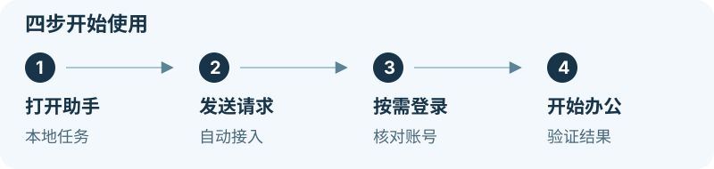

# 用 AI 助手操作石墨

**简体中文** · [English](../en/agent/README.md) · [文档导航](../README.md)

告诉助手要做什么，它负责安装 CLI、接入技能、检查账号并执行任务。你只在需要时完成网页登录和授权。助手须能联网并执行本机命令；云端会话不能直接使用你电脑上的程序和登录状态。



*流程示意，不是客户端截图。下面四步提供完整文字说明。*

## 第 1 步：打开你正在用的助手

| 助手 | 从哪里开始 | 接入范围 |
|---|---|---|
| [WorkBuddy](workbuddy.md) | 桌面端新建本地任务，选择工作目录 | 以客户端机制为准；项目技能仅对对应项目生效 |
| [Codex](codex.md) | 选择能执行本机命令的任务与工作目录 | 由 Agent 核对实际加载的用户或项目技能 |
| [DeepSeek Harness](dsh.md) | 新建本机会话，选择工作目录 | 使用当前配置的技能目录 |
| [豆包工作](doubao.md) | 进入“工作”，选择“本地电脑” | 当前任务读取技能说明，不承诺跨会话保留 |

## 第 2 步：把这段话发给 Agent

```text
请帮我安装并配置 shimo-net，按这份说明执行：
https://github.com/shimo-office/office-suites/blob/main/docs/agent/setup.md
请自动接入当前助手的技能并验证连通，已有可用安装就复用。
完成后让我直接用自然语言操作石墨。
```

私有部署用户补充：“我们的石墨地址是 https://你的石墨域名”。Agent 会选择安装方式并完成技能接入，不需要你自己查目录、复制文件或运行命令。

## 第 3 步：有提示时完成登录或授权

账号已可用就直接继续；需要登录时，在石墨网页完成后回到对话。不要把密码、cookie 或验证码发给助手。客户端要求本人授权时，按提示确认。

接入完成要同时满足三个条件：**CLI 能运行、技能已接入、账号可访问目标服务**。Agent 应说明每项结果，以及技能对哪些项目或会话生效。只下载了文件不算全部完成。

## 第 4 步：直接说你想做什么

先尝试查找和阅读：

```text
帮我在石墨里找到“季度报告”，先列出文件名和链接；我选好后，再总结主要内容和待办事项。
```

你应得到真实文件与基于正文的总结。找不到、无权限或读取不全时，Agent 应说明原因。之后可以继续说“把这份文件下载到工作目录”，或附上文件夹链接让它新建周报；更多任务见[办公场景](../scenarios.md)。

## 下次使用与常见问题

同一环境直接发任务即可。换项目、电脑或助手时，让 Agent 检查接入范围并补齐配置。

| 遇到的情况 | 直接对 Agent 说 |
|---|---|
| 找不到命令或下载失败 | “请检查安装、命令路径和下载错误，修复后继续原任务。” |
| 未登录或账号过期 | “请帮我重新登录当前石墨环境；若刚才的写入可能成功，先核对结果再继续。” |
| 要换账号 | “请让我用另一个账号重新登录，不要继续使用原账号。” |
| 技能未加载 | “请检查技能安装位置和生效范围，完成接入后继续。” |
| 文件看不到 | “请核对文件链接和当前环境，告诉我缺少什么权限。” |

权限变更、文件锁定和彻底删除须由你在石墨网页完成。完整边界见[安全策略](../../SECURITY.md)；Agent 的安装执行细节见[自动安装说明](setup.md)。习惯自己操作终端时，转到[安装指南](../install.md)。
