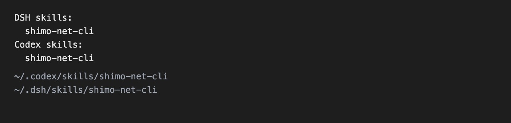
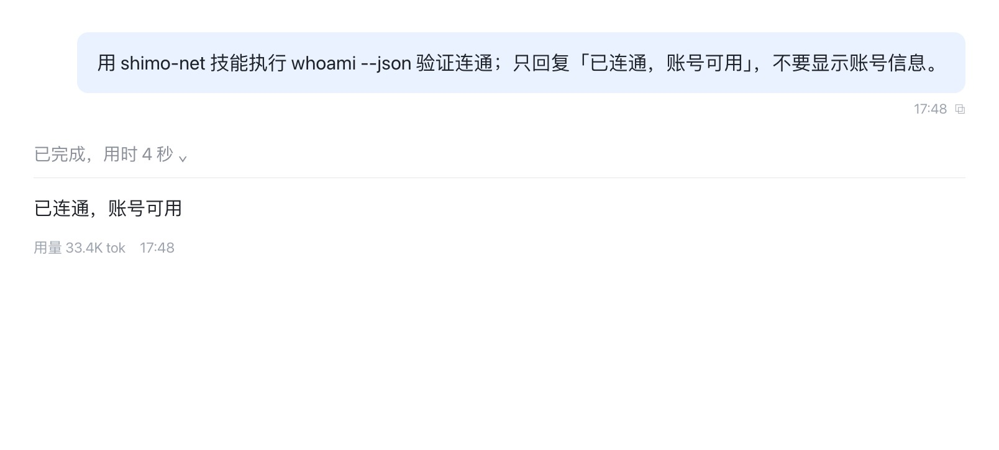

# DeepSeek Harness × 石墨办公：第一个可核对结果

适用于 shimo.net 及客户私有部署。教程配图是既有界面示意，不代表本轮重新实测；历史客户端版本和结果见[连通记录](validation.md)。

## 1. 打开宿主

打开已安装的 DSH，新建会话并选择本机工作目录。技能安装后新开会话，使宿主重新读取技能。

## 2. 检查 CLI

先运行：

```bash
shimo-net version
shimo-net doctor --json
```

缺少 CLI 时使用[安装说明](../install.md)中的 macOS/Linux 或 Windows 步骤；已有可用版本就继续。私有部署按该文档设置 origin，不要把客户地址写成通用默认值。

## 3. 检查会话

先执行 `shimo-net whoami --json`。仅在没有已存凭据时尝试复用浏览器会话；已有会话过期或 origin 不匹配时不自动换号，按[登录与会话](../install.md)处理。切账号必须执行 `shimo-net login --new`，`logout` 后再普通 `login` 可能仍复用原账号。不要把账号或 cookie 发进任务。

## 4. 接入技能或本机工具

在仓库根目录执行；已有同一技能时先检查版本，避免重复目录：

```bash
mkdir -p ~/.dsh/skills/shimo-net-cli
cp docs/agent/SKILL.md ~/.dsh/skills/shimo-net-cli/SKILL.md
```

Windows 使用安装器或按当前 DSH 配置的技能目录复制同一权威文件。



## 5. 执行第一个任务

把下面的话发给 DeepSeek Harness：

```text
用 shimo-net 执行 whoami --json 验证连通；只回复“已连通，账号可用”或实际错误，不要显示账号信息。
```

只有实际命令成功才能报告连通；截图中的旧版本或示例文字不能代替本次返回值。



## 6. 核对一个真实文件

提供当前账号有权限访问的文件链接，再发：

```text
用 shimo-net info <链接> 返回名称、文件类型和文件链接；逐项依据实际返回，不要显示账号信息。
```

确认三项来自目标文件，返回的链接可打开。无需为了连通验收创建或改写业务文件。

页面任务按[浏览器优先级](../scenarios.md#浏览器优先级)处理，不在本教程维护第二套顺序。判断当前宿主的实际工具，不能把某一旧版本的能力当成所有版本的结论。

## 7. 继续使用业务场景

找文件、创建文件夹、读写表格和页面编辑均从[唯一场景清单](../scenarios.md)进入；动作参数和退出码见[命令参考](../cli-reference.md)。表格底色使用 `editor --action sheet-format` 的 `attrs.background`，不能因教程沿用旧图就退回相反流程。

## 常见问题

- 找不到命令：按[安装与环境检查](../install.md)确认 PATH 和 `doctor` 结果。
- 401、未登录或需要切账号：按[安装说明](../install.md)检查本机会话；换账号使用 `login --new`，不是 `logout` 后普通 `login`。
- 页面未加载或截图为空：等待真实编辑器就绪后重试只读核验；若写入可能已受理，先读回，不重复提交。
