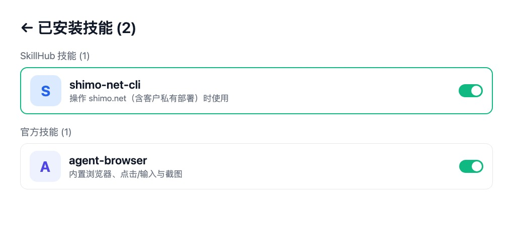
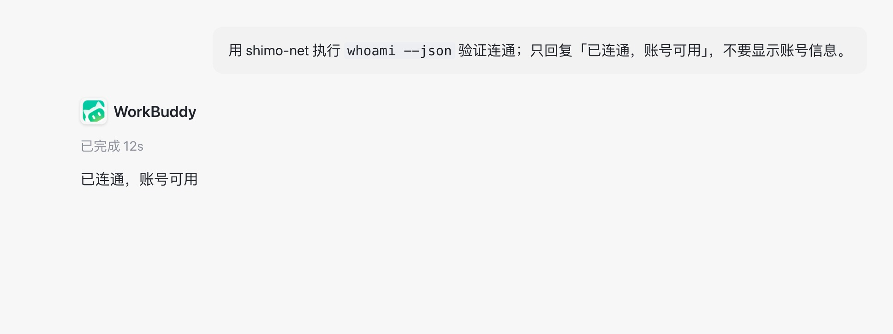

# WorkBuddy × 石墨办公：第一个可核对结果

适用于 shimo.net 及客户私有部署。教程配图是既有界面示意，不代表本轮重新实测；历史客户端版本和结果见[连通记录](validation.md)。

## 1. 打开宿主

打开已安装的 WorkBuddy 桌面端，新建任务。CLI 或技能已经可用时直接复用，不重复安装。

## 2. 检查 CLI

先运行：

```bash
shimo-net version
shimo-net doctor --json
```

缺少 CLI 时使用[安装说明](../install.md)中的 macOS/Linux 或 Windows 步骤；已有可用版本就继续。私有部署按该文档设置 origin，不要把客户地址写成通用默认值。

## 3. 检查会话

先执行 `shimo-net whoami --json`。仅在没有已存凭据时尝试复用浏览器会话；已有会话过期或 origin 不匹配时不自动换号，按[登录与会话](../install.md)处理。切账号必须执行 `shimo-net login --new`，`logout` 后再普通 `login` 可能仍复用原账号。不要把账号或 cookie 发进任务。

## 4. 接入技能或本机工具

shimo-net-cli 来自 **SkillHub**，不在 WorkBuddy 内置技能市场。打开 [SkillHub 分享页](https://www.workbuddy.cn/share/asset?extra_from=&resource_type=link&shareCode=cs261116r5dG5qMyyGQqvMFkG0pjYT&share_way=link&sig=lXMg0jOdaNQCDJnv)，安装后在“已安装”中确认启用；不要上传旧路径的兼容跳转文件。

`agent-browser` 是独立的浏览器工具，不是 shimo-net-cli 技能，也不是 WorkBuddy 自带面板；只有[浏览器规则](../scenarios.md#浏览器优先级)要求且用户同意时才启用。是否可调用 `present_files` 等内置入口，以当前宿主实际工具为准。

维护者更新 SkillHub 时，从 [GitHub Release](https://github.com/shimo-office/office-suites/releases/latest) 下载 `shimo-net-cli-v<版本>-skillhub.zip` 并上传。包内仅有根目录 `SKILL.md` 和 `LICENSE.md`，包含 SkillHub 所需元数据；不要上传整仓 `Source code (zip)`。CLI 二进制仍单独安装或升级。发布流程自动生成此包，本地可执行 `python3 scripts/package_skillhub.py --tag v<版本>` 构建到 `dist/`。



## 5. 执行第一个任务

把下面的话发给 WorkBuddy：

```text
请检查 SkillHub 版 shimo-net-cli 是否已安装并启用，再用 shimo-net 执行 whoami --json。仅根据实际结果回复是否连通，不要输出账号明细。
```

只有实际命令成功才能报告连通；截图中的旧版本或示例文字不能代替本次返回值。



## 6. 核对一个真实文件

提供当前账号有权限访问的文件链接，再发：

```text
用 shimo-net info <链接> 返回名称、文件类型和文件链接；逐项依据实际返回，不要显示账号信息。
```

确认三项来自目标文件，返回的链接可打开。无需为了连通验收创建或改写业务文件。

页面任务按[浏览器优先级](../scenarios.md#浏览器优先级)处理，不在本教程维护第二套顺序。判断当前宿主的实际工具，不能把某一旧版本的能力当成所有版本的结论。

## 7. 继续使用业务场景

找文件、创建文件夹、读写表格和页面编辑均从[唯一场景清单](../scenarios.md)进入；动作参数和退出码见[命令参考](../cli-reference.md)。表格底色使用 `editor --action sheet-format` 的 `attrs.background`，不能因教程沿用旧图就退回相反流程。

## 常见问题

- 找不到命令：按[安装与环境检查](../install.md)确认 PATH 和 `doctor` 结果。
- 401、未登录或需要切账号：按[安装说明](../install.md)检查本机会话；换账号使用 `login --new`，不是 `logout` 后普通 `login`。
- 页面未加载或截图为空：等待真实编辑器就绪后重试只读核验；若写入可能已受理，先读回，不重复提交。
