# Codex × 石墨办公：15 个协作场景图文教程

> 适用版本：Codex 0.144.0-alpha.4（CLI / IDE / 桌面）· shimo-net CLI 0.9.0
> 入口：终端 `codex`；IDE 插件；项目 `AGENTS.md` + `~/.codex/skills/`
> 生成日期：2026-11-10 · 证据等级：已实测（本机 0.144.0-alpha.4）

## 0. 这套教程怎么用

这是一套「从零到跑通」的教程，不需要写代码：

1. 按第 1 节装好客户端、CLI 和技能，`shimo-net doctor` 全绿。
2. 从 15 个场景里挑一个，照着「步骤 → 命令 → 预期结果 → 验收」做一遍。
3. 出错先看每个场景末尾的「出错怎么办」，再回到第 3 节常见问题。

> 教程里的输出是**示例数据**（域名、文件名、数量都做了脱敏）。你跑出来的链接和数量会不同，验收看的是「结构 + 可定位」，不是逐字一致。

## 1. 安装与接入

### 1.1 你会装哪几样东西

| 组件 | 作用 | 版本 |
|---|---|---|
| Codex | 你日常对话的 Agent 入口 | 0.144.0-alpha.4 |
| shimo-net CLI | 直连石墨 `/api/v1` 的命令行 | 0.9.0 |
| shimo-net-cli 技能 | 让 Agent 知道什么时候用 CLI | 0.9.0 |
| Chrome / Edge | 登录窗口与导出兜底 | 本机已装 |

### 1.2 安装 Codex

1. 安装 Codex CLI（`npm i -g @openai/codex`）或 IDE 插件
2. `codex login` 完成 OpenAI 账号登录
3. 在项目目录启动 `codex`，确认可执行命令

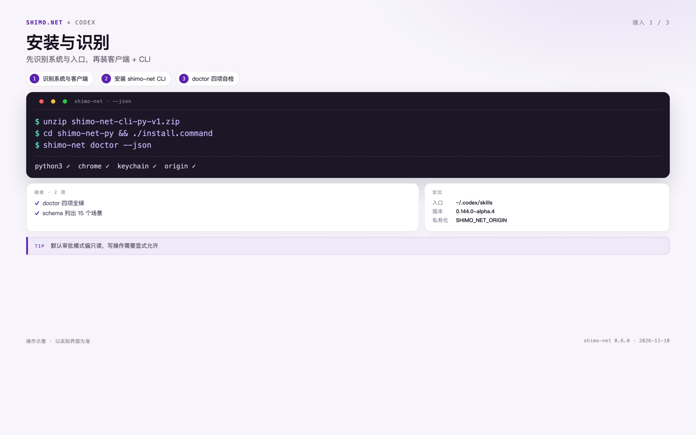

### 1.3 安装 shimo-net CLI

在终端执行：

```bash
git clone https://github.com/shimo-office/office-suites.git
cd office-suites
./install.command
shimo-net doctor --json
```

`doctor` 会检查四项：Go 二进制、Chrome、凭据、origin。四项全绿再往下。

### 1.4 把技能装进 Codex

1. `mkdir -p ~/.codex/skills/shimo-net-cli`
2. 把 `cli/SKILL.md` 复制到该目录，确认 `SKILL.md` 在根
3. 在项目 `AGENTS.md` 写：涉及石墨 / shimo.net 时优先用 `shimo-net` 命令

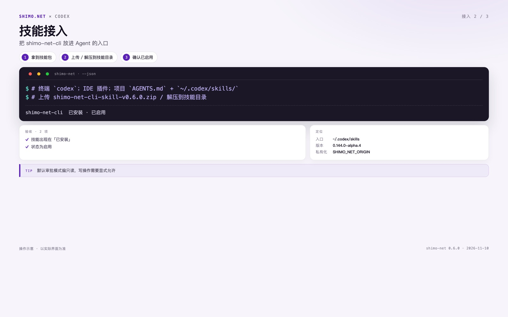

### 1.5 授权与登录

1. 首次命令执行选择允许（或使用 `--full-auto` 前先小范围验证）
2. 在终端执行 `shimo-net login`，用 Chrome 窗口登录石墨
3. `shimo-net whoami --json` 返回账号即授权完成

```bash
shimo-net login
shimo-net whoami --json
shimo-net doctor --json
```

> 不要把密码、cookie 粘进对话；凭据在 macOS Keychain，浏览器会话在 `~/.shimo-net-cli/chrome-profile`。

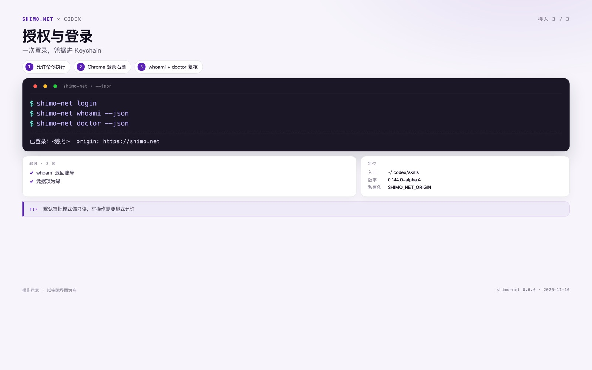

### 1.6 客户私有化环境

如果客户用的是私有化地址，不改配置文件，只在命令前加环境变量：

```bash
SHIMO_NET_ORIGIN=https://<客户域名> shimo-net whoami --json
SHIMO_NET_ORIGIN=https://<客户域名> shimo-net search "关键词" --json
```

切换后先 `whoami` 确认账号，再执行写操作；私有化环境与 shimo.net 数据不互通。

### 1.7 连接自检清单

- [ ] `shimo-net doctor --json` 四项全绿
- [ ] `shimo-net whoami --json` 返回账号
- [ ] `shimo-net schema` 能列出 15 个场景
- [ ] Codex 的「已安装」里能看到 `shimo-net-cli` 且为启用
- [ ] 能跑通 `shimo-net search "AI Agent" --limit 3 --json`

## 2. 15 个场景

每个场景都按同一结构：一句话 → 你会说 → 前置 → 步骤 → 命令 → 预期 → 验收 → 出错怎么办。

<section class="scenario">
<a id="s01"></a>
## 场景 01 · 找文件 / 文件夹 / 空间

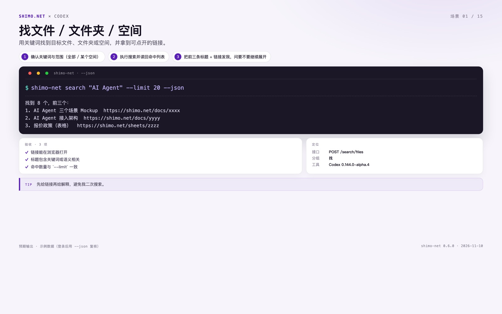

**一句话**：不用记路径，描述即搜。用关键词找到目标文件、文件夹或空间，并拿到可点开的链接。

**你可以这样说**：「找一下 AI Agent 相关的文档」；「有没有叫『报价政策』的那份表」

**前置**：已登录；有一个关键词

**步骤**

1. 在 Codex 新建任务，打开 [场景清单](../../cli/scenarios.md)，复制场景 01 的整段指令。
2. 粘贴发送；缺参数时按 Agent 的提问补齐。
3. 确认关键词与范围（全部 / 某个空间）
4. 执行搜索并读回命中列表
5. 把前三条标题 + 链接发我，问要不要继续展开

**命令**

```bash
$ shimo-net search "AI Agent" --limit 20 --json
```

**预期结果（示例）**

```text
找到 8 个，前三个：
1. AI Agent 三个场景 Mockup  https://shimo.net/docs/xxxx
2. AI Agent 接入架构  https://shimo.net/docs/yyyy
3. 报价政策（表格）  https://shimo.net/sheets/zzzz
```

**验收**

- [ ] 链接能在浏览器打开
- [ ] 标题包含关键词或语义相关
- [ ] 命中数量与 `--limit` 一致

**出错怎么办**

| 现象 | 处理 |
|---|---|
| 0 条结果 | 换同义词/更短关键词，或按「内容搜索」再试一次 |
| 401 未登录 | 执行 `shimo-net login`，成功后重试本条 |
| 结果太多 | 按类型/空间收窄，或先给前 3 条让我选 |

</section>

<section class="scenario">
<a id="s02"></a>
## 场景 02 · 看空间 / 目录里有什么

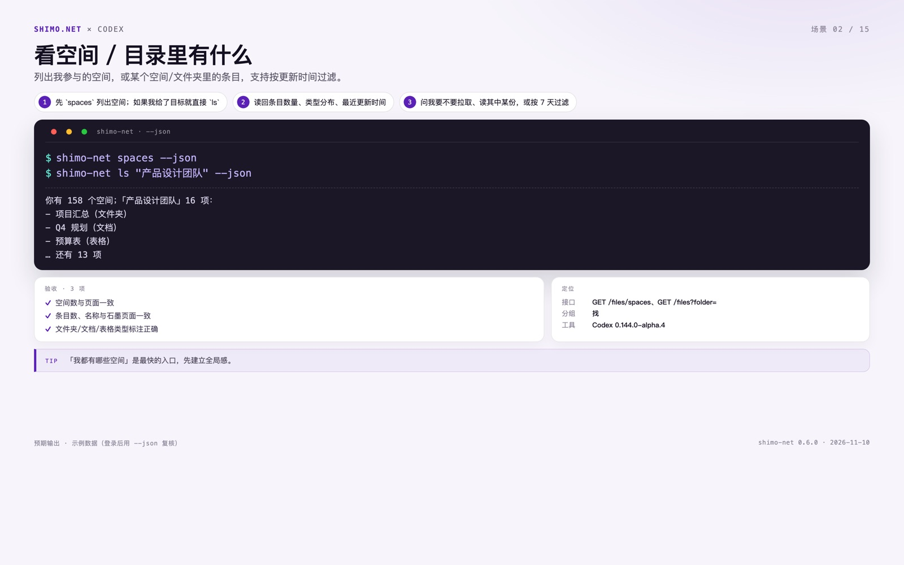

**一句话**：先看全局，再看局部。列出我参与的空间，或某个空间/文件夹里的条目，支持按更新时间过滤。

**你可以这样说**：「我都在哪些空间？」；「产品设计团队里有什么？」

**前置**：已登录；知道空间或文件夹名字

**步骤**

1. 在 Codex 新建任务，打开 [场景清单](../../cli/scenarios.md)，复制场景 02 的整段指令。
2. 粘贴发送；缺参数时按 Agent 的提问补齐。
3. 先 `spaces` 列出空间；如果我给了目标就直接 `ls`
4. 读回条目数量、类型分布、最近更新时间
5. 问我要不要拉取、读其中某份，或按 7 天过滤

**命令**

```bash
$ shimo-net spaces --json
$ shimo-net ls "产品设计团队" --json
```

**预期结果（示例）**

```text
你有 158 个空间；「产品设计团队」16 项：
- 项目汇总（文件夹）
- Q4 规划（文档）
- 预算表（表格）
… 还有 13 项
```

**验收**

- [ ] 空间数与页面一致
- [ ] 条目数、名称与石墨页面一致
- [ ] 文件夹/文档/表格类型标注正确

**出错怎么办**

| 现象 | 处理 |
|---|---|
| 目标重名 | 列出候选空间让我选，不要猜 |
| 目录为空 | 说明是空目录或无权限，并给出上级路径 |
| 条目超过 200 | 分页读，先给前 50 条 |

</section>

<section class="scenario">
<a id="s03"></a>
## 场景 03 · 文件出处与权限

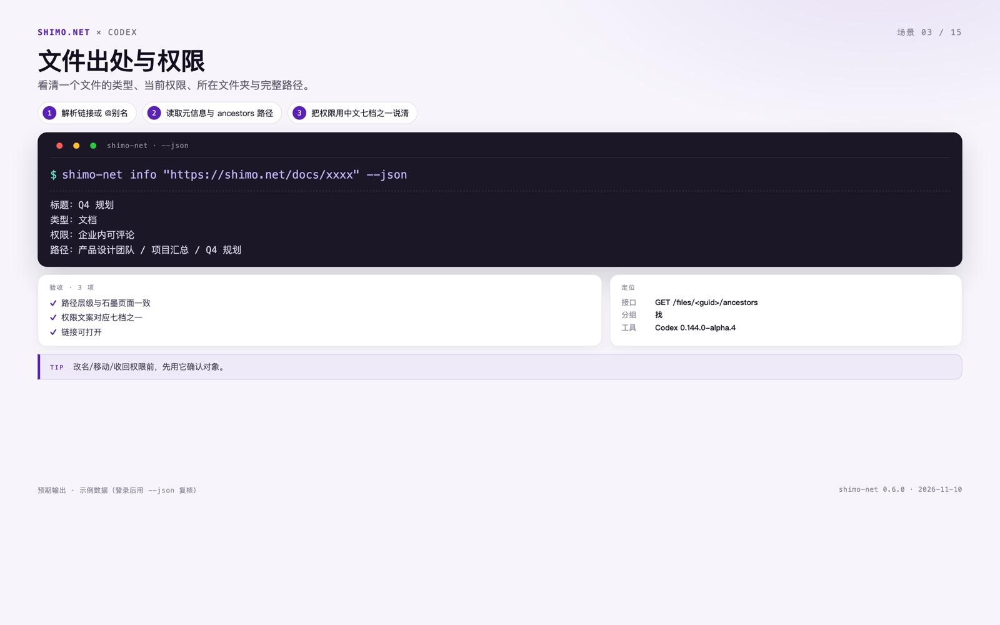

**一句话**：类型、权限、完整路径一次说清。看清一个文件的类型、当前权限、所在文件夹与完整路径。

**你可以这样说**：「它在哪个文件夹 / 空间？」；「把完整路径发我」

**前置**：已登录；有文件链接或 guid

**步骤**

1. 在 Codex 新建任务，打开 [场景清单](../../cli/scenarios.md)，复制场景 03 的整段指令。
2. 粘贴发送；缺参数时按 Agent 的提问补齐。
3. 解析链接或 @别名
4. 读取元信息与 ancestors 路径
5. 把权限用中文七档之一说清

**命令**

```bash
$ shimo-net info "https://shimo.net/docs/xxxx" --json
```

**预期结果（示例）**

```text
标题：Q4 规划
类型：文档
权限：企业内可评论
路径：产品设计团队 / 项目汇总 / Q4 规划
```

**验收**

- [ ] 路径层级与石墨页面一致
- [ ] 权限文案对应七档之一
- [ ] 链接可打开

**出错怎么办**

| 现象 | 处理 |
|---|---|
| 无权限 | 如实说「当前账号无权限」，不编路径 |
| 链接失效 | 请我重新给链接或关键词 |
| 私有化域名 | 命令前加 `SHIMO_NET_ORIGIN=https://<客户域名>` |

</section>

<section class="scenario">
<a id="s04"></a>
## 场景 04 · 导入交付 + 问权限

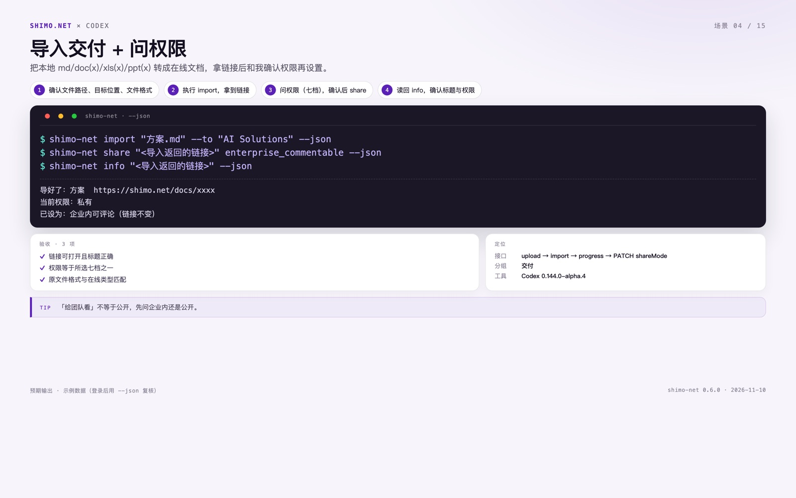

**一句话**：本地文件转在线文档，链接出来再定权限。把本地 md/doc(x)/xls(x)/ppt(x) 转成在线文档，拿链接后和我确认权限再设置。

**你可以这样说**：「把这个 md 导到 AI Solutions，给团队看」；「导入后发我链接」

**前置**：已登录；本地有 md/doc(x)/xls(x)/ppt(x) 文件，知道目标位置

**步骤**

1. 在 Codex 新建任务，打开 [场景清单](../../cli/scenarios.md)，复制场景 04 的整段指令。
2. 粘贴发送；缺参数时按 Agent 的提问补齐。
3. 确认文件路径、目标位置、文件格式
4. 执行 import，拿到链接
5. 问权限（七档），确认后 share
6. 读回 info，确认标题与权限

**命令**

```bash
$ shimo-net import "方案.md" --to "AI Solutions" --json
$ shimo-net share "<导入返回的链接>" enterprise_commentable --json
$ shimo-net info "<导入返回的链接>" --json
```

**预期结果（示例）**

```text
导好了：方案  https://shimo.net/docs/xxxx
当前权限：私有
已设为：企业内可评论（链接不变）
```

**验收**

- [ ] 链接可打开且标题正确
- [ ] 权限等于所选七档之一
- [ ] 原文件格式与在线类型匹配

**出错怎么办**

| 现象 | 处理 |
|---|---|
| 格式不支持 | 只支持 md/doc(x)/xls(x)/ppt(x)，其他直说 |
| 目标不存在/无权限 | 列出可选位置让我重选 |
| 导入超时 | 给任务链接/进度，稍后重试 `info` |

</section>

<section class="scenario">
<a id="s05"></a>
## 场景 05 · 拉取文件夹到本地

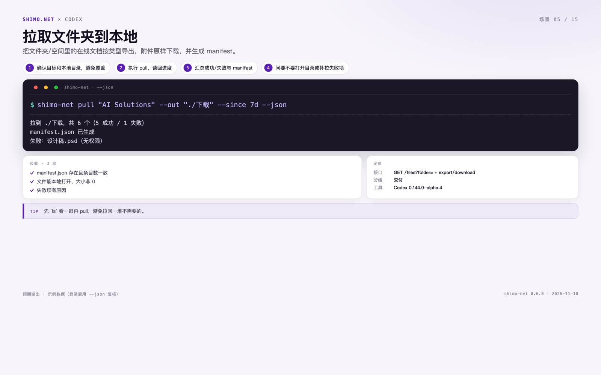

**一句话**：目录 + 附件 + manifest，一次归档。把文件夹/空间里的在线文档按类型导出，附件原样下载，并生成 manifest。

**你可以这样说**：「把这个文件夹的东西拉下来」；「归档一份到本地」

**前置**：已登录；知道文件夹/空间，本地有可写目录

**步骤**

1. 在 Codex 新建任务，打开 [场景清单](../../cli/scenarios.md)，复制场景 05 的整段指令。
2. 粘贴发送；缺参数时按 Agent 的提问补齐。
3. 确认目标和本地目录，避免覆盖
4. 执行 pull，读回进度
5. 汇总成功/失败与 manifest
6. 问要不要打开目录或补拉失败项

**命令**

```bash
$ shimo-net pull "AI Solutions" --out "./下载" --since 7d --json
```

**预期结果（示例）**

```text
拉到 ./下载，共 6 个（5 成功 / 1 失败）
manifest.json 已生成
失败：设计稿.psd（无权限）
```

**验收**

- [ ] manifest.json 存在且条目数一致
- [ ] 文件能本地打开、大小非 0
- [ ] 失败项有原因

**出错怎么办**

| 现象 | 处理 |
|---|---|
| 目录已存在同名文件 | 先列冲突，让我选覆盖/跳过 |
| 大量文件 | 先列目录再按需拉，避免整库导出 |
| 导出超时 | 记录失败项，稍后重试单个 `get` |

</section>

<section class="scenario">
<a id="s06"></a>
## 场景 06 · 新建空白文档 / 表格 / 幻灯片

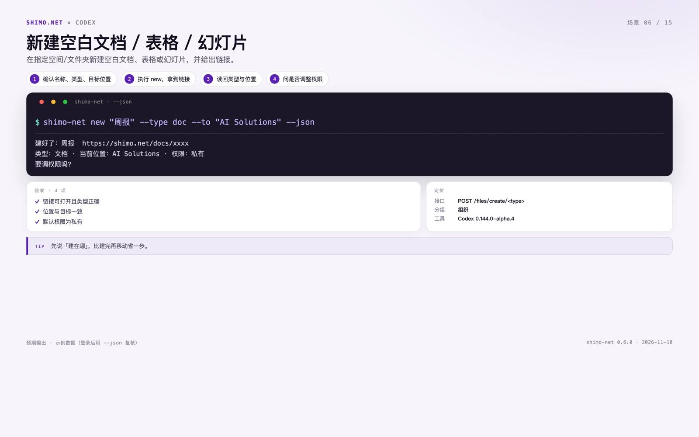

**一句话**：指定位置新建，默认私有。在指定空间/文件夹新建空白文档、表格或幻灯片，并给出链接。

**你可以这样说**：「在 AI Solutions 新建一份空白文档，叫周报」；「建个表格放这周数据」

**前置**：已登录；知道文件名、类型和目标位置

**步骤**

1. 在 Codex 新建任务，打开 [场景清单](../../cli/scenarios.md)，复制场景 06 的整段指令。
2. 粘贴发送；缺参数时按 Agent 的提问补齐。
3. 确认名称、类型、目标位置
4. 执行 new，拿到链接
5. 读回类型与位置
6. 问是否调整权限

**命令**

```bash
$ shimo-net new "周报" --type doc --to "AI Solutions" --json
```

**预期结果（示例）**

```text
建好了：周报  https://shimo.net/docs/xxxx
类型：文档 · 当前位置：AI Solutions · 权限：私有
要调权限吗？
```

**验收**

- [ ] 链接可打开且类型正确
- [ ] 位置与目标一致
- [ ] 默认权限为私有

**出错怎么办**

| 现象 | 处理 |
|---|---|
| 重名 | 自动加日期后缀或让我改名 |
| 目标无权限 | 列出可写位置让我选 |
| 类型不支持 | 支持 doc/sheet/slide（另含 table/form/mindmap/flowchart） |

</section>

<section class="scenario">
<a id="s07"></a>
## 场景 07 · 改名（单份 / 批量）


**一句话**：改标题不改链接。修改文件名/标题，单份或批量，逐条返回结果。

**你可以这样说**：「把这份改名成『方案 v2』」；「这几个都去掉『草稿』」

**前置**：已登录；有文件链接，知道新名字

**步骤**

1. 在 Codex 新建任务，打开 [场景清单](../../cli/scenarios.md)，复制场景 07 的整段指令。
2. 粘贴发送；缺参数时按 Agent 的提问补齐。
3. 确认目标与命名规则
4. 单份直接 rename；批量先给清单预览
5. 读回新标题与链接
6. 汇总失败项（无权限/重名）

**命令**

```bash
$ shimo-net rename "https://shimo.net/docs/xxxx" "方案 v2" --json
```

**预期结果（示例）**

```text
已改名：方案 v2
链接不变：https://shimo.net/docs/xxxx
```

**验收**

- [ ] 新标题正确
- [ ] 链接与 guid 不变
- [ ] 批量时逐条有结果

**出错怎么办**

| 现象 | 处理 |
|---|---|
| 无权限 | 跳过并标注「无权限」，不重试 |
| 重名 | 提示重名，让我决定加后缀还是覆盖 |
| 批量规则歧义 | 先给前后对照表让我确认 |

</section>

<section class="scenario">
<a id="s08"></a>
## 场景 08 · 删除 → 回收站 → 恢复

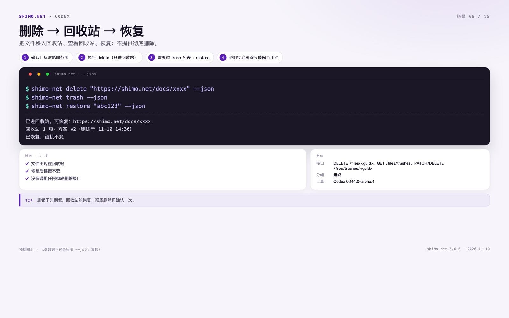

**一句话**：删除只进回收站，不可逆操作留在网页。把文件移入回收站、查看回收站、恢复；不提供彻底删除。

**你可以这样说**：「把刚才那份自检文档删了」；「算了，恢复回来」

**前置**：已登录；有要删除的文件链接

**步骤**

1. 在 Codex 新建任务，打开 [场景清单](../../cli/scenarios.md)，复制场景 08 的整段指令。
2. 粘贴发送；缺参数时按 Agent 的提问补齐。
3. 确认目标与影响范围
4. 执行 delete（只进回收站）
5. 需要时 trash 列表 + restore
6. 说明彻底删除只能网页手动

**命令**

```bash
$ shimo-net delete "https://shimo.net/docs/xxxx" --json
$ shimo-net trash --json
$ shimo-net restore "abc123" --json
```

**预期结果（示例）**

```text
已进回收站，可恢复：https://shimo.net/docs/xxxx
回收站 1 项：方案 v2（删除于 11-10 14:30）
已恢复，链接不变
```

**验收**

- [ ] 文件出现在回收站
- [ ] 恢复后链接不变
- [ ] 没有调用任何彻底删除接口

**出错怎么办**

| 现象 | 处理 |
|---|---|
| 删除后想彻底删 | 说明 CLI 不提供，引导到网页回收站 |
| 恢复 guid 错误 | 先 `trash` 列出候选让我选 |
| 无权限删除 | 如实说无权限，不重试 |

</section>

<section class="scenario">
<a id="s09"></a>
## 场景 09 · 权限巡检：哪些是公开的

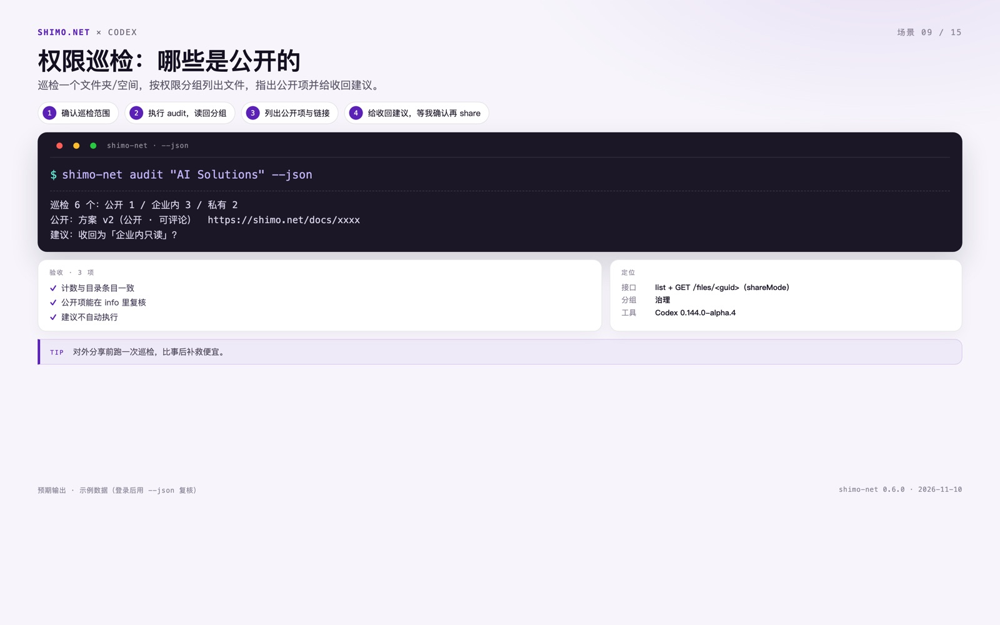

**一句话**：公开 / 企业内 / 私有一眼看穿。巡检一个文件夹/空间，按权限分组列出文件，指出公开项并给收回建议。

**你可以这样说**：「看看这个空间里哪些文件是公开的」；「有没有外链」

**前置**：已登录；知道要巡检的文件夹/空间

**步骤**

1. 在 Codex 新建任务，打开 [场景清单](../../cli/scenarios.md)，复制场景 09 的整段指令。
2. 粘贴发送；缺参数时按 Agent 的提问补齐。
3. 确认巡检范围
4. 执行 audit，读回分组
5. 列出公开项与链接
6. 给收回建议，等我确认再 share

**命令**

```bash
$ shimo-net audit "AI Solutions" --json
```

**预期结果（示例）**

```text
巡检 6 个：公开 1 / 企业内 3 / 私有 2
公开：方案 v2（公开 · 可评论）  https://shimo.net/docs/xxxx
建议：收回为「企业内只读」？
```

**验收**

- [ ] 计数与目录条目一致
- [ ] 公开项能在 info 里复核
- [ ] 建议不自动执行

**出错怎么办**

| 现象 | 处理 |
|---|---|
| 无权限读某项 | 单列为「未知」，不当作私有 |
| 公开项很多 | 先给数量和前 5 条，问要不要全量 |
| 误报 | 用 `info` 复核 shareMode 再下结论 |

</section>

<section class="scenario">
<a id="s10"></a>
## 场景 10 · 批量改权限

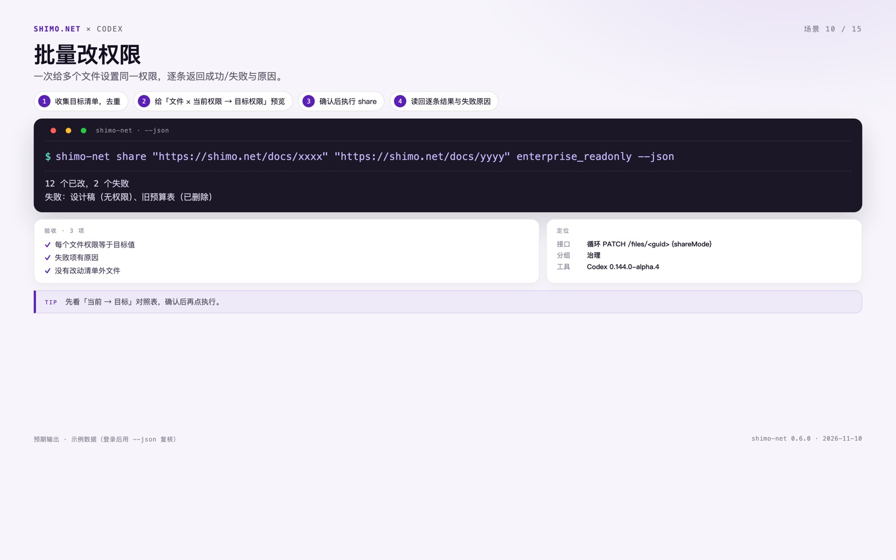

**一句话**：逐条成功/失败，不静默。一次给多个文件设置同一权限，逐条返回成功/失败与原因。

**你可以这样说**：「把这些都改成企业内可编辑」；「全收回成私有」

**前置**：已登录；有多个文件链接，知道目标权限

**步骤**

1. 在 Codex 新建任务，打开 [场景清单](../../cli/scenarios.md)，复制场景 10 的整段指令。
2. 粘贴发送；缺参数时按 Agent 的提问补齐。
3. 收集目标清单，去重
4. 给「文件 × 当前权限 → 目标权限」预览
5. 确认后执行 share
6. 读回逐条结果与失败原因

**命令**

```bash
$ shimo-net share "https://shimo.net/docs/xxxx" "https://shimo.net/docs/yyyy" enterprise_readonly --json
```

**预期结果（示例）**

```text
12 个已改，2 个失败
失败：设计稿（无权限）、旧预算表（已删除）
```

**验收**

- [ ] 每个文件权限等于目标值
- [ ] 失败项有原因
- [ ] 没有改动清单外文件

**出错怎么办**

| 现象 | 处理 |
|---|---|
| 包含无权限文件 | 跳过并单列，不中断整批 |
| 目标权限不是七档 | 列七档让我选 |
| 公开权限风险 | 二次确认，提示外链风险 |

</section>

<section class="scenario">
<a id="s11"></a>
## 场景 11 · 读正文 / 出摘要

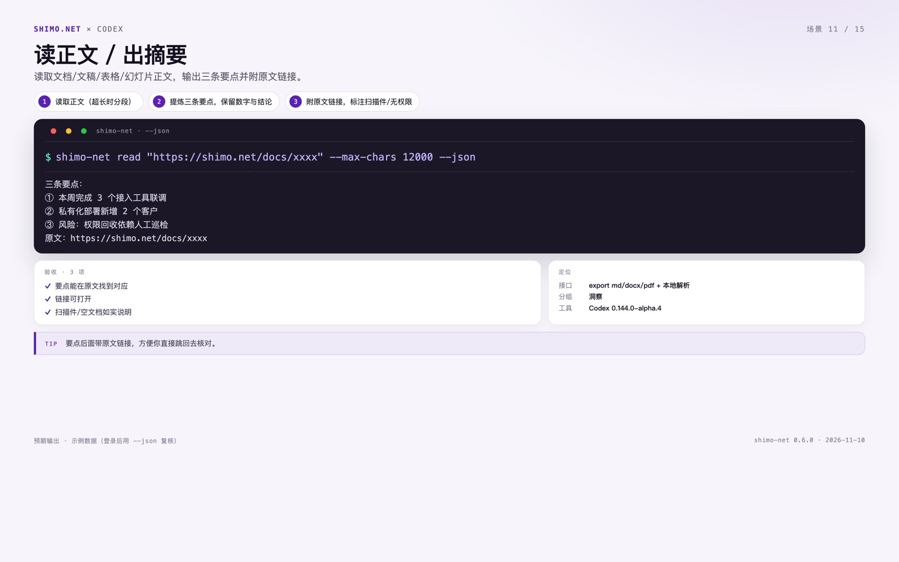

**一句话**：三条要点，带原文链接。读取文档/文稿/表格/幻灯片正文，输出三条要点并附原文链接。

**你可以这样说**：「读一下这份文档，给我三条要点」；「这份 PPT 讲了什么」

**前置**：已登录；有文档/PPT/表格链接

**步骤**

1. 在 Codex 新建任务，打开 [场景清单](../../cli/scenarios.md)，复制场景 11 的整段指令。
2. 粘贴发送；缺参数时按 Agent 的提问补齐。
3. 读取正文（超长时分段）
4. 提炼三条要点，保留数字与结论
5. 附原文链接，标注扫描件/无权限

**命令**

```bash
$ shimo-net read "https://shimo.net/docs/xxxx" --max-chars 12000 --json
```

**预期结果（示例）**

```text
三条要点：
① 本周完成 3 个接入工具联调
② 私有化部署新增 2 个客户
③ 风险：权限回收依赖人工巡检
原文：https://shimo.net/docs/xxxx
```

**验收**

- [ ] 要点能在原文找到对应
- [ ] 链接可打开
- [ ] 扫描件/空文档如实说明

**出错怎么办**

| 现象 | 处理 |
|---|---|
| 扫描件读不出 | 说明是图片型，建议先转文字版 |
| 超长文档 | 分段读，先给目录/结论 |
| 无权限 | 如实说，不编内容 |

</section>

<section class="scenario">
<a id="s12"></a>
## 场景 12 · 跨文件夹周报 / 一页纸

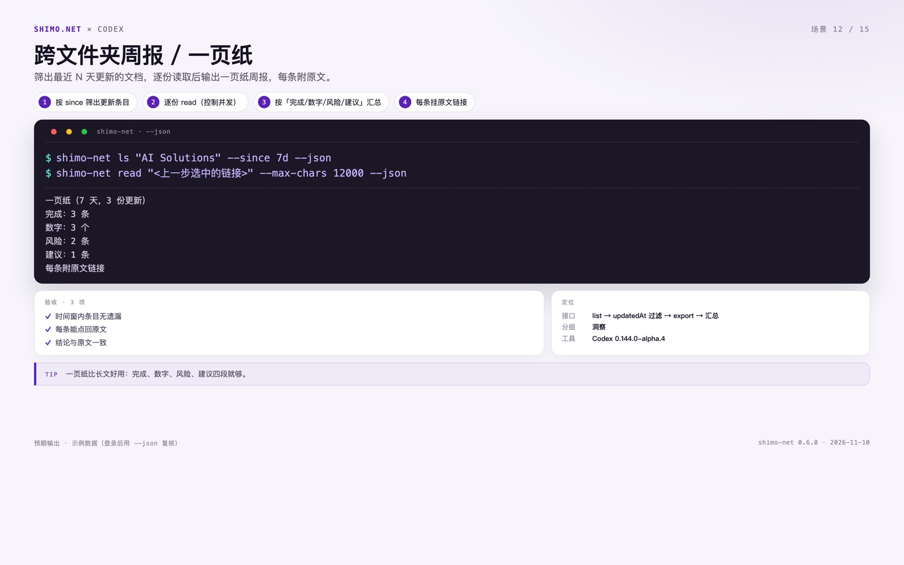

**一句话**：按更新时间筛，读完再汇总。筛出最近 N 天更新的文档，逐份读取后输出一页纸周报，每条附原文。

**你可以这样说**：「把这周更新的文档读一遍，出周报」；「给我一页纸重点」

**前置**：已登录；知道范围，默认最近 7 天

**步骤**

1. 在 Codex 新建任务，打开 [场景清单](../../cli/scenarios.md)，复制场景 12 的整段指令。
2. 粘贴发送；缺参数时按 Agent 的提问补齐。
3. 按 since 筛出更新条目
4. 逐份 read（控制并发）
5. 按「完成/数字/风险/建议」汇总
6. 每条挂原文链接

**命令**

```bash
$ shimo-net ls "AI Solutions" --since 7d --json
$ shimo-net read "<上一步选中的链接>" --max-chars 12000 --json
```

**预期结果（示例）**

```text
一页纸（7 天，3 份更新）
完成：3 条
数字：3 个
风险：2 条
建议：1 条
每条附原文链接
```

**验收**

- [ ] 时间窗内条目无遗漏
- [ ] 每条能点回原文
- [ ] 结论与原文一致

**出错怎么办**

| 现象 | 处理 |
|---|---|
| 没有更新 | 如实说，问要不要放宽到 14 天 |
| 文档太多 | 先汇总标题，按重要性读前 N 份 |
| 读取失败 | 单列失败项，不省略 |

</section>

<section class="scenario">
<a id="s13"></a>
## 场景 13 · 附件 / 云文件下载

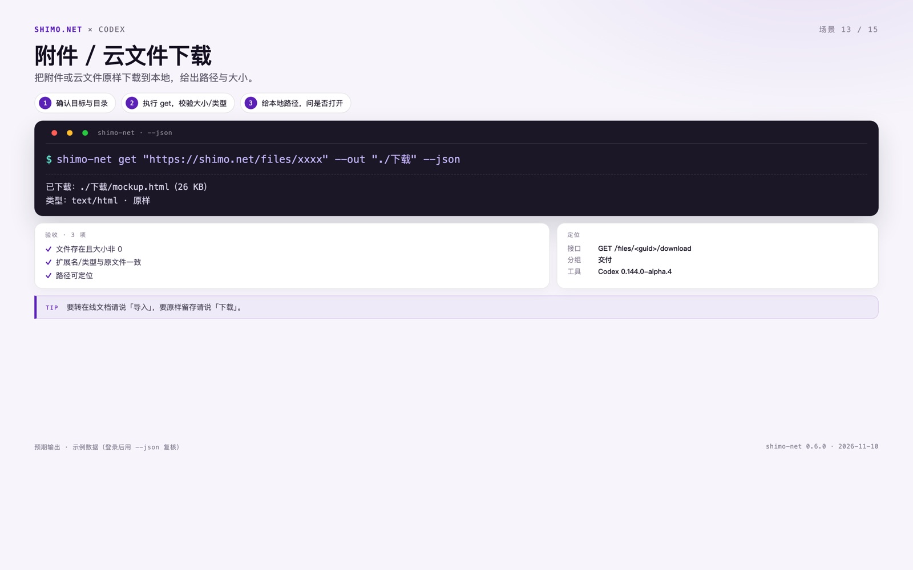

**一句话**：原样下载，不转格式。把附件或云文件原样下载到本地，给出路径与大小。

**你可以这样说**：「把那个 HTML 附件下载下来」；「原图发我」

**前置**：已登录；有附件/云文件链接

**步骤**

1. 在 Codex 新建任务，打开 [场景清单](../../cli/scenarios.md)，复制场景 13 的整段指令。
2. 粘贴发送；缺参数时按 Agent 的提问补齐。
3. 确认目标与目录
4. 执行 get，校验大小/类型
5. 给本地路径，问是否打开

**命令**

```bash
$ shimo-net get "https://shimo.net/files/xxxx" --out "./下载" --json
```

**预期结果（示例）**

```text
已下载：./下载/mockup.html（26 KB）
类型：text/html · 原样
```

**验收**

- [ ] 文件存在且大小非 0
- [ ] 扩展名/类型与原文件一致
- [ ] 路径可定位

**出错怎么办**

| 现象 | 处理 |
|---|---|
| 密码保护 | 说明需要先在网页验证 |
| 无权限 | 如实说，不生成空文件 |
| 文件名冲突 | 自动加序号，告诉我实际路径 |

</section>

<section class="scenario">
<a id="s14"></a>
## 场景 14 · 上传（先问传到哪里）


**一句话**：先定位置，再传原文件。上传本地文件为云文件，上传前先确认位置（桌面 / 空间 / 文件夹 / @别名）。

**你可以这样说**：「把这个 pdf 传上去」；「传到哪里？」

**前置**：已登录；本地有文件，知道传到哪里

**步骤**

1. 在 Codex 新建任务，打开 [场景清单](../../cli/scenarios.md)，复制场景 14 的整段指令。
2. 粘贴发送；缺参数时按 Agent 的提问补齐。
3. 先问位置（不给就列可选位置）
4. 确认文件与目标
5. 执行 upload，读回链接/大小
6. 提醒原样上传，转文档用 import

**命令**

```bash
$ shimo-net upload "报告.pdf" --to "@ai" --json
```

**预期结果（示例）**

```text
已上传：报告.pdf  https://shimo.net/files/xxxx
位置：AI Solutions · 26 KB · 云文件（原样）
要转在线文档请说「导入」
```

**验收**

- [ ] 文件在目标位置可见
- [ ] 大小与原文件一致
- [ ] 类型为云文件而非在线文档

**出错怎么办**

| 现象 | 处理 |
|---|---|
| 位置不明确 | 列出桌面/空间/文件夹/@别名让我选 |
| 同名文件 | 先问覆盖还是改名 |
| 网络失败 | 重试一次，仍失败给错误原因 |

</section>

<section class="scenario">
<a id="s15"></a>
## 场景 15 · 常用文件夹别名

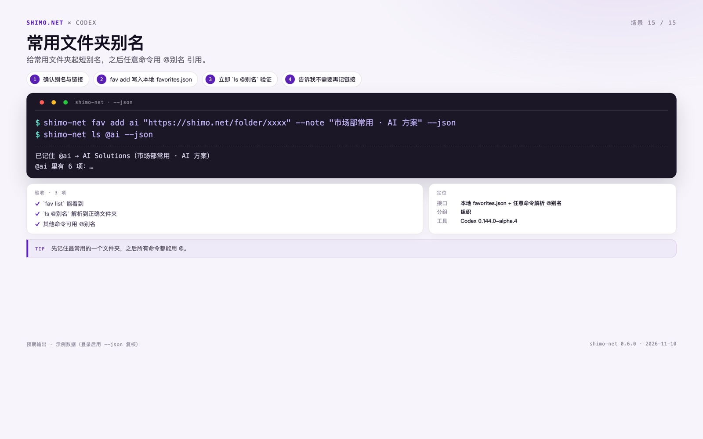

**一句话**：记住一次，处处可用。给常用文件夹起短别名，之后任意命令用 @别名 引用。

**你可以这样说**：「以后我说『AI 方案』就是那个文件夹」；「@ai 里有什么」

**前置**：已登录；有一个常用文件夹链接

**步骤**

1. 在 Codex 新建任务，打开 [场景清单](../../cli/scenarios.md)，复制场景 15 的整段指令。
2. 粘贴发送；缺参数时按 Agent 的提问补齐。
3. 确认别名与链接
4. fav add 写入本地 favorites.json
5. 立即 `ls @别名` 验证
6. 告诉我不需要再记链接

**命令**

```bash
$ shimo-net fav add ai "https://shimo.net/folder/xxxx" --note "市场部常用 · AI 方案" --json
$ shimo-net ls @ai --json
```

**预期结果（示例）**

```text
已记住 @ai → AI Solutions（市场部常用 · AI 方案）
@ai 里有 6 项：…
```

**验收**

- [ ] `fav list` 能看到
- [ ] `ls @别名` 解析到正确文件夹
- [ ] 其他命令可用 @别名

**出错怎么办**

| 现象 | 处理 |
|---|---|
| 别名冲突 | 列出现有别名，让我改名或覆盖 |
| 链接不是文件夹 | 提示别名只对文件夹/空间生效 |
| 换机器 | favorites.json 不跟随账号，需重新添加 |

</section>

## 3. 常见问题

### 3.1 未登录 / 401

执行 `shimo-net login`，Chrome 窗口登录后重试原命令。网址已记住，不用重新配置。

### 3.2 命令找不到

`shimo-net` 默认装到 `~/.local/bin`；确认它在 `PATH` 里，或直接用 `~/.local/bin/shimo-net`。

### 3.3 导入失败

只支持 `md / doc(x) / xls(x) / ppt(x)`；扫描版 PDF 需要先转文字，或改用 `upload` 原样上传。

### 3.4 无权限

Agent 会如实说「当前账号无权限」，不会编路径或内容。换有权限的账号，或让管理员加权限。

### 3.5 客户私有化

每条命令前加 `SHIMO_NET_ORIGIN=https://<客户域名>`；登录窗口也会用该域名。

## 4. 安全边界

- 删除只进回收站；CLI 不提供彻底删除，彻底删除到石墨网页回收站手动操作。
- 上传/导入先确认位置；导入后先问权限，默认私有。
- 批量读取/下载/改权限会消耗服务端资源，控制并发，避免全量扫描。
- 凭据存 Keychain；不把密码、cookie 粘进对话。

> 返回目录：[图文教程](README.md) · [CLI 用法](../../cli/README.md)