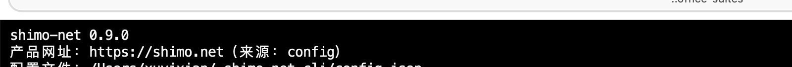
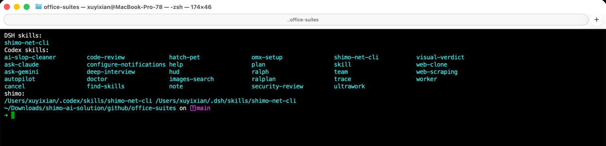
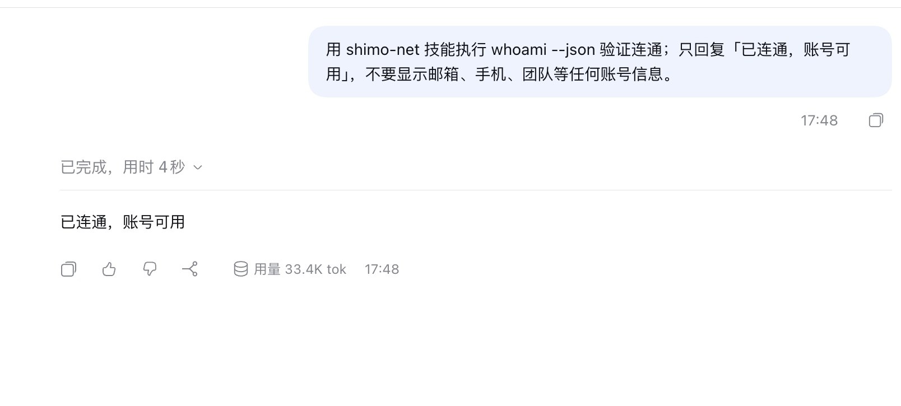
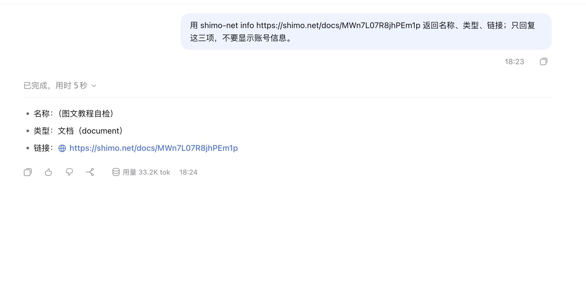

# DeepSeek Harness × 石墨办公：从打开到第一个结果

> 适用版本：DeepSeek Harness 0.2.1-rc.3（桌面客户端）· shimo-net CLI 0.9.1  
> 适用对象：shimo.net 客户及私有化部署客户。照做，20 分钟内完成「打开 DSH → 装 CLI → 登录 → 装技能 → 跑出真实结果」。  

## 0. 开始前

- 已经安装好的 DeepSeek Harness（不需要重新下载）；
- 一个能登录 shimo.net 的账号；
- macOS「终端」或 Windows PowerShell；
- 能访问 GitHub。

## 0.1 一句话让 Agent 自己配置（推荐）

把下面整段发给 DeepSeek Harness，不要自己开终端：

```text
请帮我完成 shimo-net 的安装和配置：
1. 执行：curl -fsSL https://github.com/shimo-office/office-suites/releases/download/v0.9.1/bootstrap.sh | bash -s -- dsh
2. 如果弹出 Chrome 登录页，我会登录；登录成功后继续。
3. 用 ~/.local/bin/shimo-net whoami --json 验证，只回复「已配置完成，账号可用」，不要显示账号信息。
如果脚本失败，返回完整错误信息。
```

它会下载 CLI、写入技能目录、打开登录页。完成后新建一个 DSH 会话，让技能生效。

> 脚本公开可审计：https://github.com/shimo-office/office-suites/blob/main/bootstrap.sh（release 镜像：v0.9.1 附件 bootstrap.sh）  
> 如果 Agent 不执行命令或网络失败，再按下面的手工步骤做。

## 1. 打开 DeepSeek Harness

打开已安装的 DSH，点「新会话」，确认能看到输入框和工作目录选择。


## 2. 安装 shimo-net CLI

macOS 终端：

```bash
git clone https://github.com/shimo-office/office-suites.git
cd office-suites
./install.command
shimo-net version
shimo-net doctor --json
```

Windows PowerShell：

```powershell
git clone https://github.com/shimo-office/office-suites.git
cd office-suites
powershell -ExecutionPolicy Bypass -File .\install.ps1
shimo-net version
shimo-net doctor --json
```

看到版本和配置就对了：



如果提示 `shimo-net: command not found`：

```bash
export PATH="$HOME/.local/bin:$PATH"
```

想永久生效，把这一行加到 `~/.zshrc`，再 `source ~/.zshrc`。Windows 关掉 PowerShell 重新打开。

## 3. 登录授权

```bash
shimo-net login
```

Chrome 窗口里登录 shimo.net，成功后回到终端：

```bash
shimo-net whoami --json
```

返回账号即授权完成。会话存在 macOS Keychain（Windows 是凭据管理器），**下次不用再登录**。

> 登录页会显示账号，教程不截这张图；用 `whoami` 返回作为授权验收。

返回「未登录」时：

```bash
shimo-net logout
shimo-net login
shimo-net whoami --json
```

## 4. 安装技能

DSH 从 `~/.dsh/skills` 读取技能，不需要在应用里点安装：

```bash
mkdir -p ~/.dsh/skills/shimo-net-cli
cp cli/SKILL.md ~/.dsh/skills/shimo-net-cli/SKILL.md
```

确认目录里已经有 `shimo-net-cli`：



看到 `DSH skills:` 下面有 `shimo-net-cli` 就对了。重启 DSH 或新建一个会话，让技能生效。

## 5. 第一个任务：验证连通

在 DSH 新会话里粘贴：

```text
用 shimo-net 执行 whoami --json 验证连通；只回复「已连通，账号可用」，不要显示账号信息。
```



4 秒左右返回「已连通，账号可用」，说明 DSH 能执行本机命令、CLI 在 PATH、登录态有效、技能已加载。

## 6. 第二个任务：真实操作

```text
用 shimo-net info https://shimo.net/docs/MWn7L07R8jhPEm1p 返回名称、类型、链接；只回复这三项，不要显示账号信息。
```



看到「名称 / 类型 / 链接」三项，并且链接能打开，就完成了从授权到结果的闭环。

> 截图里的「（图文教程自检）」是演示文档；实际使用时换成自己的链接。

## 7. 当前场景怎么用

流程和上面一样：在 DSH 里说人话，Agent 调用 `shimo-net`。

| # | 场景 | 在 DSH 里说 | 对应命令 |
|---|---|---|---|
| 01 | 找文件 | 帮我找一下「季度方案」，最多 5 条 | `shimo-net search "季度方案" --limit 5 --json` |
| 02 | 看目录 | 看看这个文件夹里有什么：<链接> | `shimo-net ls <链接> --json` |
| 03 | 文件出处 | 这份文档在哪个空间、谁有权限：<链接> | `shimo-net info <链接> --json` |
| 04 | 导入并设权限 | 把这份 docx 导到「交付」文件夹，先私有 | `shimo-net import ./file.docx --to <文件夹> --share private --json` |
| 05 | 拉取文件夹 | 把这个文件夹拉到本地 ./交付 | `shimo-net pull <链接> --out ./交付 --json` |
| 06 | 新建文档 | 在桌面新建一个文档，叫「会议纪要」 | `shimo-net new "会议纪要" --type doc --to desktop --json` |
| 07 | 改名 | 把「会议纪要」改名为「周会纪要」 | `shimo-net rename <链接> "周会纪要" --json` |
| 08 | 删除/恢复 | 把这份文档移到回收站；再恢复 | `shimo-net delete <链接>` / `shimo-net restore <guid>` |
| 09 | 权限巡检 | 看看这个文件夹里哪些是公开的 | `shimo-net audit <文件夹> --json` |
| 10 | 批量改权限 | 把这个文件夹里的文档都改成「组织内可读」 | 先 `audit`，再逐条 `share <链接> enterprise_readonly` |
| 11 | 读正文 | 读一下这份文档，给我 5 条摘要 | `shimo-net read <链接> --max-chars 12000` |
| 12 | 周报 | 把这个文件夹最近 7 天的内容整理成一页纸 | `shimo-net ls <链接> --since 7d` + `shimo-net read` |
| 13 | 下载附件 | 把这份文档的附件下载到 ./附件 | `shimo-net get <链接> --out ./附件` |
| 14 | 上传 | 把这个 PDF 传到「资料」文件夹，先私有 | `shimo-net upload ./file.pdf --to <文件夹>` |
| 15 | 常用别名 | 以后把「交付」文件夹叫「交付」 | `shimo-net fav add 交付 <链接> --note 交付目录` |

> 写操作执行前，Agent 会先确认位置和权限；删除只进回收站。

## 8. 验收清单

- [ ] DSH 能打开新会话；
- [ ] `shimo-net version` 输出 `0.9.1`；
- [ ] `shimo-net whoami --json` 返回账号；
- [ ] `~/.dsh/skills/shimo-net-cli/SKILL.md` 存在；
- [ ] 第一个任务返回「已连通，账号可用」；
- [ ] 第二个任务返回「名称 / 类型 / 链接」；
- [ ] 当前场景里至少完整跑通 1 个。

## 9. 常见问题

**Q：找不到 `shimo-net`？**  
执行 `export PATH="$HOME/.local/bin:$PATH"`，或重新打开终端。

**Q：`whoami` 未登录？**  
`shimo-net logout` → `shimo-net login` → 重试；不要重复 `init`。

**Q：技能没生效？**  
确认 `~/.dsh/skills/shimo-net-cli/SKILL.md` 存在，退出 DSH 再打开；也可以在新会话里直接写「用 shimo-net 执行 …」明确点名。

**Q：DSH 不执行本地命令？**  
在 DSH 里允许「执行本地命令 / 访问工作目录」，再发一次任务。

**Q：Windows 上 Keychain 是什么？**  
Windows 用凭据管理器，CLI 存在 `shimo-net-cli` 目标下，不需要手动打开。
