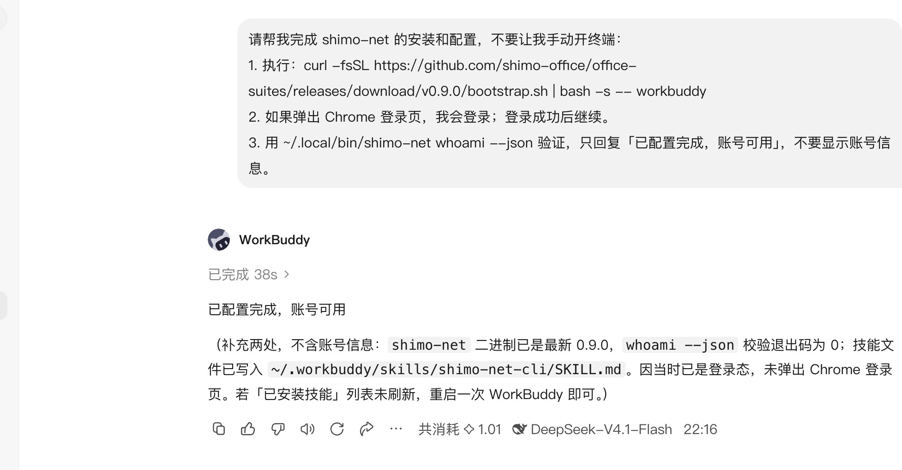
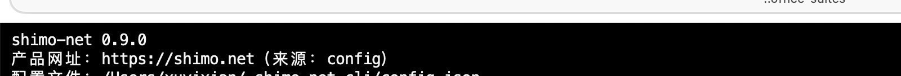
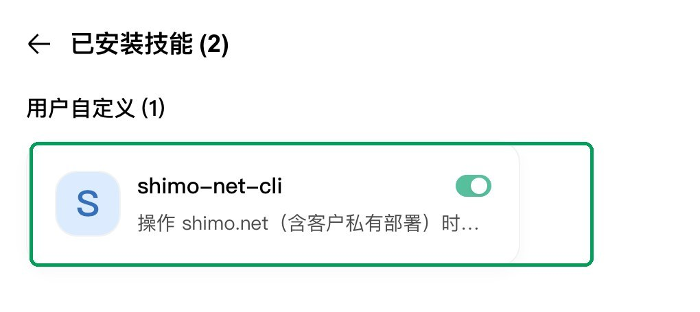
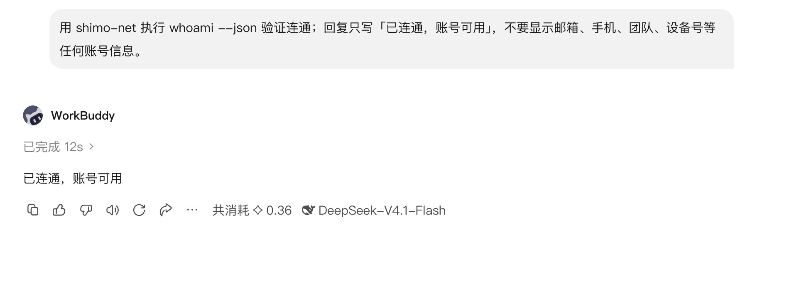
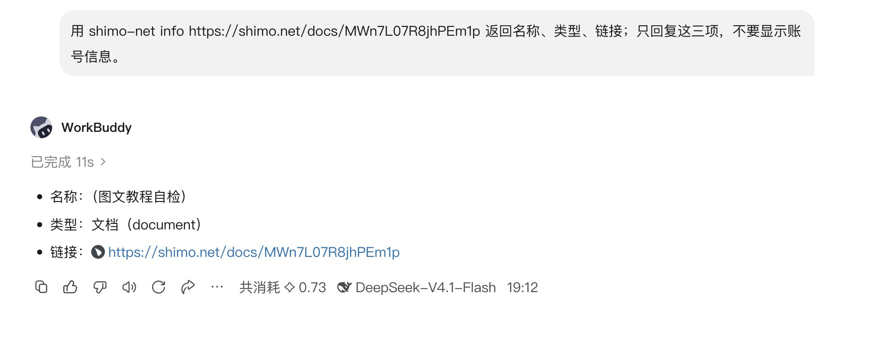

# WorkBuddy × 石墨办公：从打开到第一个结果

> 适用版本：WorkBuddy 5.9.3（桌面客户端）· shimo-net CLI 0.9.1  
> 适用对象：shimo.net 客户及私有化部署客户。照着做，20 分钟内完成「打开 Agent → 装 CLI → 登录授权 → 装技能 → 跑出第一个真实结果」。  

## 0. 开始前

你只需要准备：

- 已经安装好的 WorkBuddy 桌面端（不需要重新下载）；
- 一个能登录 shimo.net 的账号；
- macOS 的「终端」，或 Windows 的 PowerShell；
- 能访问 GitHub（安装 CLI 用）。

不需要会写代码；命令都可以直接复制。

## 0.1 一句话让 Agent 自己配置（推荐）

把下面整段发给 WorkBuddy，不要自己开终端：

```text
请帮我完成 shimo-net 的安装和配置：
1. 执行：curl -fsSL https://github.com/shimo-office/office-suites/releases/download/v0.9.1/bootstrap.sh | bash -s -- workbuddy
2. 如果弹出 Chrome 登录页，我会登录；登录成功后继续。
3. 用 ~/.local/bin/shimo-net whoami --json 验证，只回复「已配置完成，账号可用」，不要显示账号信息。
如果脚本失败，返回完整错误信息。
```

它会下载 CLI、写入技能目录、打开登录页。登录完成后，如果「已安装技能」没刷新，退出 WorkBuddy 再打开一次；如果它问是否允许执行命令，选允许。

> 脚本公开可审计：https://github.com/shimo-office/office-suites/blob/main/bootstrap.sh（release 镜像：v0.9.1 附件 bootstrap.sh）  
> 如果 Agent 不执行命令或网络失败，再按下面的手工步骤做。

真实执行结果（WorkBuddy 5.9.3，38 秒）：



## 1. 打开 WorkBuddy

从「应用程序」打开 WorkBuddy，确认能看到任务输入框。看到「WorkBuddy，我帮你」和输入框就对了；这张空白首页不用截图，直接进入下一步。

## 2. 安装 shimo-net CLI

打开「终端」，复制整段执行：

```bash
git clone https://github.com/shimo-office/office-suites.git
cd office-suites
./install.command
shimo-net version
shimo-net doctor --json
```

Windows 用 PowerShell：

```powershell
git clone https://github.com/shimo-office/office-suites.git
cd office-suites
powershell -ExecutionPolicy Bypass -File .\install.ps1
shimo-net version
shimo-net doctor --json
```

正常情况下会看到版本号和配置信息：



你要确认三件事：

1. `shimo-net version` 输出 `shimo-net 0.9.1`；
2. `shimo-net config show` 显示 `https://shimo.net`；
3. `doctor --json` 的 `ok` 为 `true`，`checks` 五项都是 `ok`；终端最后一行显示 `结果：🟢 doctor: OK`。

装完后如果提示 `shimo-net: command not found`，先执行：

```bash
export PATH="$HOME/.local/bin:$PATH"
```

想永久生效，把这一行加到 `~/.zshrc` 末尾，再执行 `source ~/.zshrc`。Windows 关掉 PowerShell 重新打开一次，安装脚本会写入用户 PATH。

## 3. 登录授权

在终端执行：

```bash
shimo-net login
```

会弹出一个 Chrome 窗口：

1. 用你的 shimo.net 账号登录；
2. 看到登录成功提示后，Chrome 会自动关闭；
3. 回到终端，执行：

```bash
shimo-net whoami --json
```

返回账号信息就代表授权完成。CLI 会把会话存进 macOS Keychain（Windows 是凭据管理器），**下次不用再登录**。

> 登录页会显示你的账号，教程不截这张图；用 `whoami` 的返回结果作为授权验收即可。

如果返回「未登录」：

```bash
shimo-net logout
shimo-net login
shimo-net whoami --json
```

## 4. 把技能装进 WorkBuddy

WorkBuddy 需要知道「什么时候该用 shimo-net」。装一次技能即可。

1. 左侧栏点「专家 · 技能 · 连接器」；
2. 点「技能」；
3. 点右上角「添加技能」；
4. 选择仓库里的 `cli/SKILL.md` 上传；
5. 安装完成后，在「已安装」里找 `shimo-net-cli`；如果没看到，按下面的 fallback 复制一份。

装好后打开「已安装技能」，应该看到：



判断标准不是「上传成功」，而是这里同时满足：

- 「用户自定义」下出现 `shimo-net-cli`；
- 右侧开关是绿色（已启用）。

如果上传入口不可用，用终端复制到 WorkBuddy 实际扫描的目录：

```bash
mkdir -p ~/.workbuddy/skills/shimo-net-cli
cp cli/SKILL.md ~/.workbuddy/skills/shimo-net-cli/SKILL.md
```

然后退出 WorkBuddy 再打开一次，再回「已安装技能」确认。

装好之后不需要每次手动挑技能：在任务里直接写「用 shimo-net …」，Agent 会按技能描述自动调用。后面的任务都是这种方式。

## 5. 第一个任务：验证连通

回到 WorkBuddy，点「新建任务」，在输入框里粘贴：

```text
用 shimo-net 执行 whoami --json 验证连通；只回复「已连通，账号可用」，不要显示账号信息。
```

点发送，等 10–20 秒。你应该看到：



出现「已连通，账号可用」就说明：

- WorkBuddy 能执行本机命令；
- `shimo-net` 在 PATH 里；
- 登录态有效；
- 技能已经被调用。

如果没有执行命令，先检查第 4 步的技能是否启用，再检查 WorkBuddy 是否允许「执行本地命令 / 访问工作目录」。

## 6. 第二个任务：跑一个真实操作

连通只说明「能调用」，再跑一个真实操作，确认结果能落地。

在 WorkBuddy 新任务里粘贴（把链接换成你有权限的文档）：

```text
用 shimo-net info https://shimo.net/docs/MWn7L07R8jhPEm1p 返回名称、类型、链接；只回复这三项，不要显示账号信息。
```

你应该看到文档名称、类型和链接：



看到「名称 / 类型 / 链接」三项，并且链接能打开，就完成了从授权到操作结果的闭环。

> 截图里的「（图文教程自检）」是演示文档；你实际使用时换成自己的文档链接。

## 7. 当前场景怎么用

流程和上面完全一样：在 WorkBuddy 里说人话，Agent 会调用 `shimo-net`。下面是可以直接复制的任务说法。

| # | 场景 | 在 WorkBuddy 里说 | 对应命令 |
|---|---|---|---|
| 01 | 找文件 | 帮我找一下「季度方案」，最多 5 条 | `shimo-net search "季度方案" --limit 5 --json` |
| 02 | 看目录 | 看看这个文件夹里有什么：<链接> | `shimo-net ls <链接> --json` |
| 03 | 文件出处 | 这份文档在哪个空间、谁有权限：<链接> | `shimo-net info <链接> --json` |
| 04 | 导入并设权限 | 把这份 docx 导到「交付」文件夹，先私有 | `shimo-net import ./file.docx --to <文件夹> --share private --json` |
| 05 | 拉取文件夹 | 把这个文件夹拉到本地 ./交付 | `shimo-net pull <链接> --out ./交付 --json` |
| 06 | 新建文档 | 在桌面新建一个文档，叫「会议纪要」 | `shimo-net new "会议纪要" --type doc --to desktop --json` |
| 07 | 改名 | 把「会议纪要」改名为「周会纪要」 | `shimo-net rename <链接> "周会纪要" --json` |
| 08 | 删除/恢复 | 把这份文档移到回收站；再恢复 | `shimo-net delete <链接>` / `shimo-net restore <guid>` |
| 09 | 权限巡检 | 看看这个文件夹里哪些是公开的 | `shimo-net audit <文件夹> --json` |
| 10 | 批量改权限 | 把这个文件夹里的文档都改成「组织内可读」 | 先 `audit`，再逐条 `share <链接> enterprise_readonly` |
| 11 | 读正文 | 读一下这份文档，给我 5 条摘要 | `shimo-net read <链接> --max-chars 12000` |
| 12 | 周报 | 把这个文件夹最近 7 天的内容整理成一页纸 | `shimo-net ls <链接> --since 7d` + `shimo-net read` |
| 13 | 下载附件 | 把这份文档的附件下载到 ./附件 | `shimo-net get <链接> --out ./附件` |
| 14 | 上传 | 把这个 PDF 传到「资料」文件夹，先私有 | `shimo-net upload ./file.pdf --to <文件夹>` |
| 15 | 常用别名 | 以后把「交付」文件夹叫「交付」 | `shimo-net fav add 交付 <链接> --note 交付目录` |

> 写操作（导入、上传、分享、删除）执行前，Agent 会先确认位置和权限；删除只进回收站，不会彻底删除。

## 8. 验收清单

全部打勾，才算独立完成：

- [ ] WorkBuddy 能正常打开，能看到任务输入框；
- [ ] `shimo-net version` 输出 `shimo-net 0.9.1`；
- [ ] `shimo-net config show` 显示 `https://shimo.net`；
- [ ] `shimo-net whoami --json` 返回账号；
- [ ] WorkBuddy「已安装」里能看到 `shimo-net-cli`（或技能已复制到 `~/.workbuddy/skills/`）；
- [ ] 第一个任务返回「已连通，账号可用」；
- [ ] 第二个任务返回「名称 / 类型 / 链接」三项；
- [ ] 当前场景里至少完整跑通 1 个（建议 01 找文件、03 文件出处、11 读正文）。

## 9. 常见问题

**Q：WorkBuddy 说没有权限执行命令？**  
在 WorkBuddy 的任务设置里允许「执行本地命令 / 读写工作目录」，然后重新发一次任务。

**Q：`shimo-net: command not found`？**  
执行 `export PATH="$HOME/.local/bin:$PATH"`，或重新打开终端；Windows 重新打开 PowerShell。还不行就回到第 2 步重跑 `./install.command`。

**Q：`whoami` 返回「未登录」？**  
执行 `shimo-net login`，完成 Chrome 登录后重试。不要重复执行 `init`，网址已经记住。

**Q：技能装了但 Agent 不调用？**  
确认 `~/.workbuddy/skills/shimo-net-cli/SKILL.md` 存在，退出 WorkBuddy 再打开；或者直接在任务里写「用 shimo-net 执行 …」，明确点名命令。

**Q：Windows 上 Keychain 是什么？**  
Windows 用「凭据管理器」，CLI 会自动存到 `shimo-net-cli` 这个目标下，不需要手动打开。

**Q：截图里的链接打不开？**  
那是演示文档，可能已被删除；换成你自己的文档链接即可，命令格式不变。
